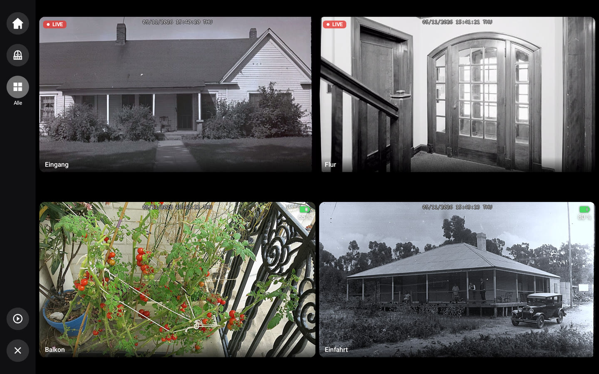
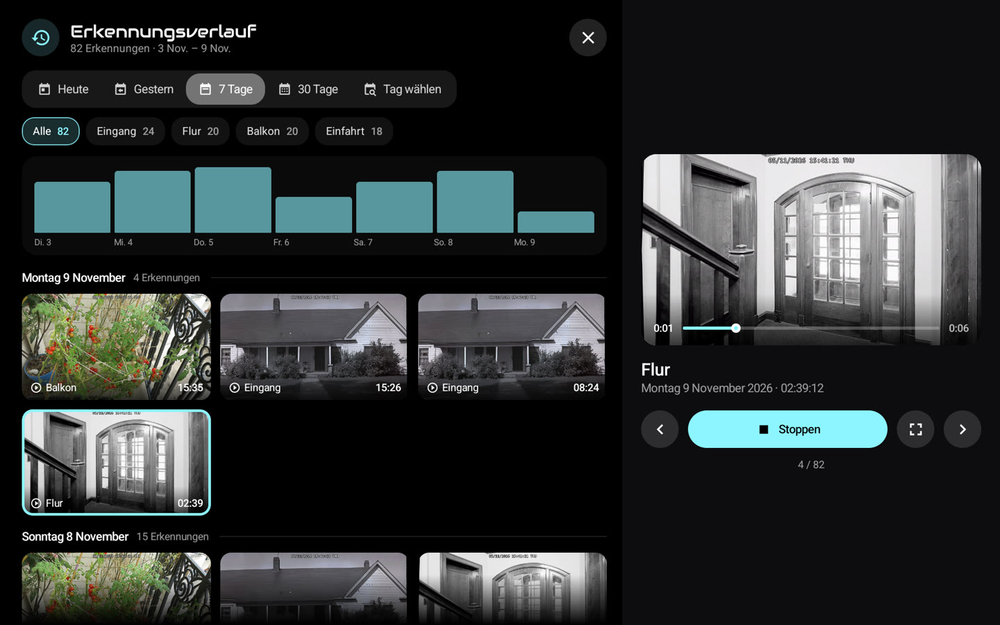

# 🏠 HA-MACS Android

[English](README.md) · [Français](README.fr.md) · **Deutsch** · [Español](README.es.md) · [Italiano](README.it.md) · [Nederlands](README.nl.md) · [Português](README.pt.md) · [Polski](README.pl.md)

Ein **natives Android-Dashboard für Home Assistant**, gemacht für Wandtablets. Es bringt das Aussehen eines
Lovelace-Kiosk-Dashboards in eine flüssige Jetpack-Compose-App, auch auf einfachen Tablets: ohne Browser, ohne
Custom Cards und ohne Einrichtung in Home Assistant.

<p align="center">
  
  
</p>
<p align="center">
  
  
</p>
<p align="center">
  
  
</p>
<p align="center">
  
  
</p>
<p align="center">📸 <em>Demodaten.</em></p>

## ✨ Funktionen

- 🤖 **M.A.C.S.**, die animierte Assistenzfigur, im Mittelpunkt des Startbildschirms, mit Uhrzeit und kurzem Wetter; seine Augen folgen Ihrem Finger
- 🧙 **Einrichtungsassistent**: Räume, Mitglieder, Kameras und wichtige Elemente werden in Home Assistant erkannt
- 🏠 **Räume**: Licht, Temperatur, Luftfeuchtigkeit und Geräte auf einen Blick
- 👨‍👩‍👧 **Mitglieder**: Anwesenheit (Balken antippen für Ankünfte und Abfahrten), Ankunftszeit, Schritte, Handy-Akku
  und anstehende Termine
- 🧑‍🎨 **Avatare**: Foto mit der Tablet-Kamera, aus einer Datei oder vom Handy (QR-Code), auf dem Gerät freigestellt,
  optionale Filter, Kopf ragt aus einem Kreis in der Farbe des Dashboards
- 📹 **Kameras**: Livebild, eigene Tabs, Vollbild in hoher Auflösung mit Zoom, letzte Erkennungen und ihr Verlauf
  (HA-Medien, SMB, NFS, lokal); Vollbild schließt sich nach einer Wartezeit selbst (Einstellungen › Anzeige), nie
  während einer Erkennung
  ; 🧱 **Kamerawand**: Raster pro Tab oder alle Kameras, über die Tabs, den Startbildschirm oder die Kachel „+N“, live
  je nach Stromversorgung (Netz, Solar, Akku); eine Türklingel kann ihre Kamera groß mit anderen als Miniaturen öffnen
- 🚨 **Warnungen**: native Umsetzung der [AlertTicker Card](https://github.com/djdevil/AlertTicker-Card), 63 Themes,
  Ton, Sprachausgabe und Benachrichtigungen
- 🌦️ **Wetter und Diagramme**: Vorhersage, Windy-Radar, Stromverbrauch, Spritpreise mit der günstigsten Tankstelle
  (Diagramm antippen: jede Tankstelle, ihr Preis und ihre letzten Änderungen)
- 🎵 **Musik**: Cover und seine Farben, Fortschritt live, Lautstärke, Zufall und Wiederholung, mehrere Player; Cover
  antippen für Mediathek, Suche, Warteschlange, Quelle und Lautsprechergruppen
- 🎙️ **Sprachassistent**: mit M.A.C.S. über dein lokales Gateway oder als **Home-Assistant-Sprachsatellit** sprechen
  (Wyoming, Assist-Pipeline, Aktivierungswort optional); Einstellungen › Sprachassistent
- ✏️ **Bearbeitungsmodus**: Entitäten, Räume, Tabs und Blöcke direkt auf dem Tablet ändern
- 🔒 **Kioskmodus**: ohne Mastercode (oder Zugangscode) lässt sich die App nicht verlassen und das Tablet nicht ausschalten
- 🌍 **8 Sprachen**: Englisch, Französisch, Deutsch, Spanisch, Italienisch, Niederländisch, Portugiesisch, Polnisch

> 💡 **Kein Sensor in Home Assistant anzulegen**: Anwesenheit, Tag/Nacht, Wetterwarnungen, bester Preis… alles wird
> von der App aus den Entitäten deiner Integrationen berechnet.

## 📋 Voraussetzungen

- 📱 Tablet mit **Android 8.0** oder neuer (z. B. Galaxy Tab A8)
- 🏡 Home Assistant vom Tablet aus erreichbar; kein Token nötig: Der Assistent meldet sich mit deinem Konto an,
  *Mit dem Handy* (QR-Code, der Passwortmanager des Handys füllt die Felder aus) oder *Auf dem Tablet*, oder nimmt ein
  *Zugriffstoken*

## 🚀 Installation

Lade die APK der [neuesten Release](https://github.com/Arubinu/ha-macs-android/releases/latest) herunter (`…-arm64-v8a.apk` für fast alle aktuellen Tablets) und
installiere sie: Danach aktualisiert sich die App selbst. Oder aus dem Quellcode bauen:

```sh
# Android SDK (Plattform 36) und JDK 17 erforderlich
./gradlew assembleFullDebug    # oder assembleLiteDebug
adb install -r app/build/outputs/apk/full/debug/app-full-debug.apk
```

🪶 **Leichte Version** `…-lite-universal.apk` (15 MB statt 50, alle Tablets): ohne Google ML Kit und ohne proprietäre
Komponenten; Avatare sind runde Fotos (kein Freistellen). Sie aktualisiert sich ebenfalls selbst und bleibt dabei leicht.

Beim ersten Start findet der **Assistent** Home Assistant im Netzwerk, meldet sich an und passt das Dashboard an dein
Zuhause an. Schon eine Sicherung? Im ersten Schritt **importieren**, fertig.

## 🍓 Raspberry Pi

Ein Raspberry Pi 4 oder 5 mit Touchscreen ergibt ein gutes Wandpanel. Zuerst Android darauf installieren:

1. 📥 **LineageOS** (Android ohne Google-Dienste): auf der Website von KonstaKANG die Seite für den [Pi 4](https://konstakang.com/devices/rpi4/) oder
   den [Pi 5](https://konstakang.com/devices/rpi5/) öffnen, die neueste LineageOS-Version wählen (nicht „Android TV“) und ihre `.zip` herunterladen
   (Abschnitt *Download*). Direkt verlinkt ist nur die neueste Version; ältere liegen unter *Previous builds*.
2. 💾 **microSD-Karte**: [Raspberry Pi Imager](https://www.raspberrypi.com/software/) installieren, das Pi-Modell wählen, dann in der Liste der
   Betriebssysteme die letzte Option, *Use custom* (eigenes Image): die heruntergeladene `.zip` und dann die Karte wählen.
3. 📲 **Die App**: den Pi starten, die Android-Einrichtung abschließen und `…-arm64-v8a.apk` aus der
   [neuesten Release](https://github.com/Arubinu/ha-macs-android/releases/latest) mit dem Browser des Pi herunterladen (Installation unbekannter Apps erlauben).

Eine USB-Webcam wählst du in Einstellungen › Ruhezustand & Anwesenheit › *Kamera*. Ohne Google-Dienste ist das
Freistellen der Avatare etwas ungenauer. Details: [technische Referenz](docs/reference.md#raspberry-pi) (Englisch).

⚡ **Stromversorgung**: das offizielle Netzteil verwenden (5,1 V / 3 A für den Pi 4, 5 V / 5 A für den Pi 5). Der Pi
handelt kein USB Power Delivery aus: ein Dock- oder Ladegerätanschluss ist oft zu schwach, besonders mit USB-Webcams.
Sinkt die Spannung (HDMI-Signal weg, Ruckeln), zeigt die App unten *Stromversorgung zu schwach* an.

## ⚙️ Im Alltag

- ⚙️ **Einstellungen**: lange auf die obere linke Ecke drücken (Verbindung, Anzeige, Ruhezustand, Zugangscode,
  Sprache…)
- 🔑 **Mastercode** (optional, im Assistenten oder unter Einstellungen › Sicherheit): wird vor dem Öffnen der
  Einstellungen abgefragt
- ✏️ **Bearbeitungsmodus**: Einstellungen › Dashboard › *Blöcke bearbeiten*, dann einen Block antippen
- 💾 **Sicherung**: Einstellungen › Dashboard › *Exportieren* / *Importieren* / *Mit dem Handy* (QR-Code); Token und
  Codes sind für dieses Tablet verschlüsselt (auf einem anderen werden neue Codes abgefragt), die Datei bleibt aber
  persönlich (Layout, Avatarfotos)
- 🔄 **Updates**: Einstellungen › Über › *Updates*; neue Versionen (und auf Wunsch Vorabversionen) werden automatisch
  installiert, die App öffnet sich nach einem Update oder Absturz von selbst wieder und zeigt einmal die *Neuigkeiten*
- 🌙 **Nachtmodus**: Einstellungen › Ruhezustand & Anwesenheit › *Nachtmodus*; von Sonnenuntergang bis -aufgang (oder
  zu festen Zeiten) wird der Bildschirm früher schwarz und wacht bei Berührung oder Anwesenheit auf
- 🔔 **Türklingel**: im Bearbeitungsmodus zeigt *Bei einem Ereignis öffnen* eine Kamera im Vollbild, wenn eine
  Klingel oder ein Melder auslöst, mit Ton
- 📡 **Tablet in Home Assistant**: Einstellungen › Home Assistant; Sensoren für Akku, Bildschirm und Anwesenheit sowie
  Benachrichtigungen (Banner, Vorlesen, Bildschirm an, Kamera im Vollbild)
- 🔊 **Mediaplayer**: Home Assistant findet das Tablet (DLNA) und kann Sprachausgabe, Radios oder Music Assistant darauf
  abspielen; Einstellungen › Home Assistant
  (Zugriff: Home Assistant und genehmigte Geräte oder das ganze Netzwerk)
- 🌍 **Zugriff über das Internet**: https-Reverse-Proxy (Pangolin, Cloudflare Access…) mit seinen Headern;
  Einstellungen › Home Assistant › *Reverse-Proxy*
- 🧙 **Assistent**: jederzeit erneut startbar unter Einstellungen › Dashboard

## 🔒 Kioskmodus

Einstellungen › Sicherheit › **Kioskmodus**. Für eine vollständige Sperre (Home, letzte Apps, Benachrichtigungen und
Ein/Aus-Menü gesperrt) die App einmalig vom Computer aus zum *Geräteinhaber* machen, ohne angemeldetes Konto auf dem
Tablet:

```sh
adb shell dpm set-device-owner fr.pergens.hamacs/.kiosk.KioskAdmin
```

📷 Ohne Computer: *Tablet vorbereiten* (unten) zeigt einen QR-Code, der nach dem Zurücksetzen auf dem
Begrüßungsbildschirm gescannt wird (6-mal auf dieselbe Stelle tippen). Einfacher: die App als Startbildschirm wählen; sie
kommt mit der Home-Taste und beim Start zurück, aber eine Android-Geste kann das Bildschirmfixieren lösen.

🔁 Als Geräteinhaber kann die App das Gerät auch neu starten: Einstellungen › Sicherheit › *Gerät neu starten*
(Android erlaubt einer App nicht, es auszuschalten).

⚠️ Vor dem Deinstallieren: Einstellungen › Sicherheit › *Geräteinhaber-Rechte entfernen*.

✅ Einstellungen › Sicherheit › *Tablet vorbereiten* prüft alles auf einmal: Kiosk, Geräteinhaber oder
Startbildschirm, Mastercode, Neustart nach einem Absturz, Akku und Animationen, jeweils mit der Lösung.

## 🎙️ Sprachassistent (optional)

Ein kleines Python-Gateway (`gateway/`, Docker-fähig) leitet das Mikrofon des Tablets an ein lokales Audiomodell
(LFM3-Audio über llama-server) weiter und führt die Home-Assistant-Aktionen aus. Einfache Befehle („schalte das Licht
im Wohnzimmer ein") werden sofort ohne Modell ausgeführt.

```sh
cd gateway && docker compose up -d
```

## 🛠️ Weiterführendes

- ❓ [FAQ](docs/faq.de.md): unterstützte Tablets, Raspberry Pi, Kameras, Updates, Probleme
- 🐛 Ein Problem? Einstellungen › Über › *Absturzprotokoll*: in einen [Fehlerbericht](https://github.com/Arubinu/ha-macs-android/issues/new/choose) kopieren
- 📖 [Technische Referenz](docs/reference.md) (auf Englisch): `dashboard.json`, Kartentypen, Erkennungen,
  AlertTicker, Bearbeitungsmodus, Sprach-Gateway

## 📄 Lizenz

Der Code steht unter der [MIT-Lizenz](LICENSE). Ressourcen Dritter behalten ihre eigene Lizenz:

- 🤖 [M.A.C.S.](https://github.com/glyndavidson/MACS) von Glyn Davidson und
  [hass-hue-icons](https://github.com/arallsopp/hass-hue-icons): **CC BY-NC-SA 4.0**, nur nicht kommerzielle Nutzung
- 🎨 [Material Design Icons](https://pictogrammers.com/library/mdi/) (Apache 2.0),
  [Meteocons](https://github.com/basmilius/weather-icons) (MIT), Schriften Audiowide und
  [Carlito](https://github.com/googlefonts/carlito) (OFL), Themes und Übersetzungen der
  [AlertTicker Card](https://github.com/djdevil/AlertTicker-Card) (MIT)
- 📚 [smbj](https://github.com/hierynomus/smbj) und [nfs-client-java](https://github.com/EMCECS/nfs-client-java)
  (Apache 2.0)
