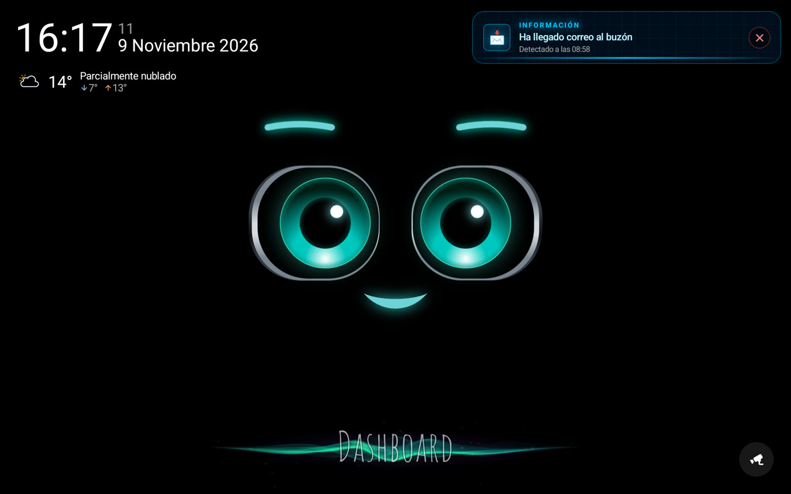
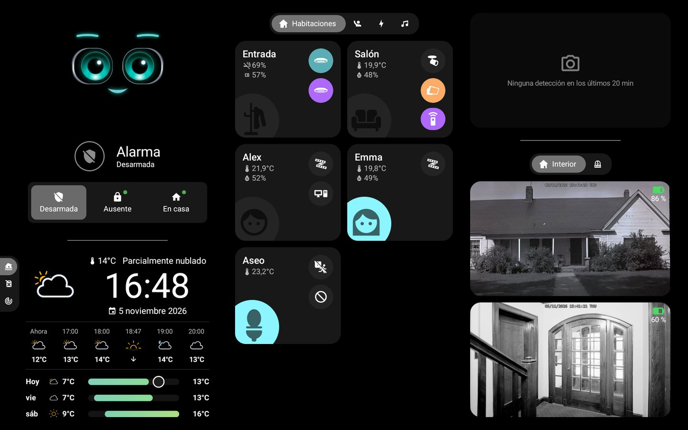
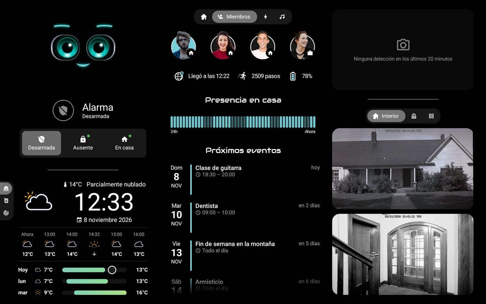
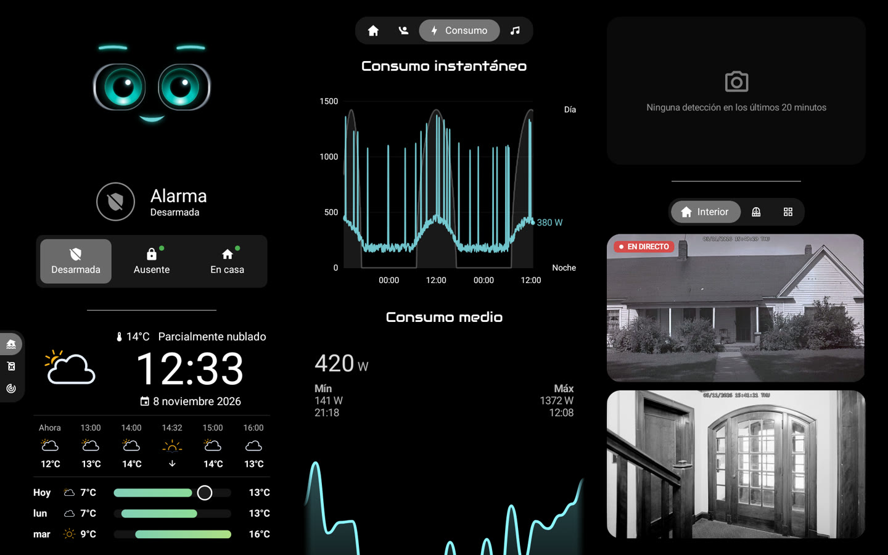
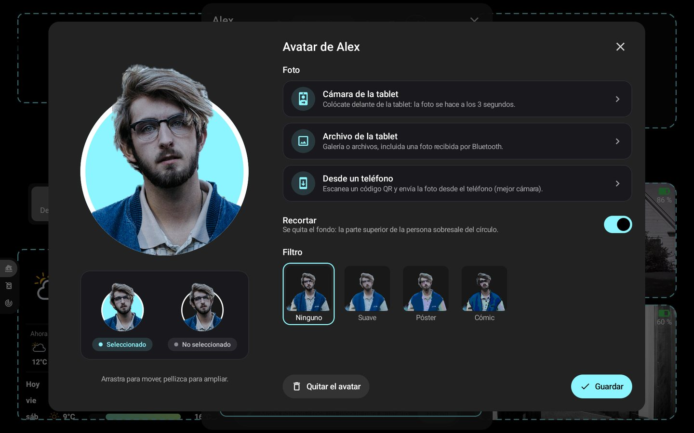
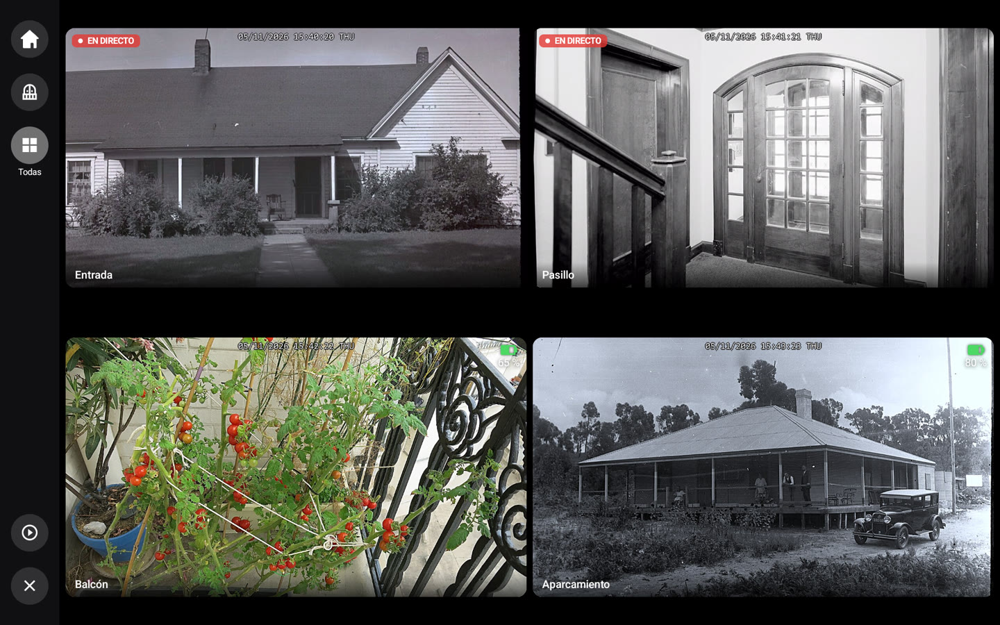
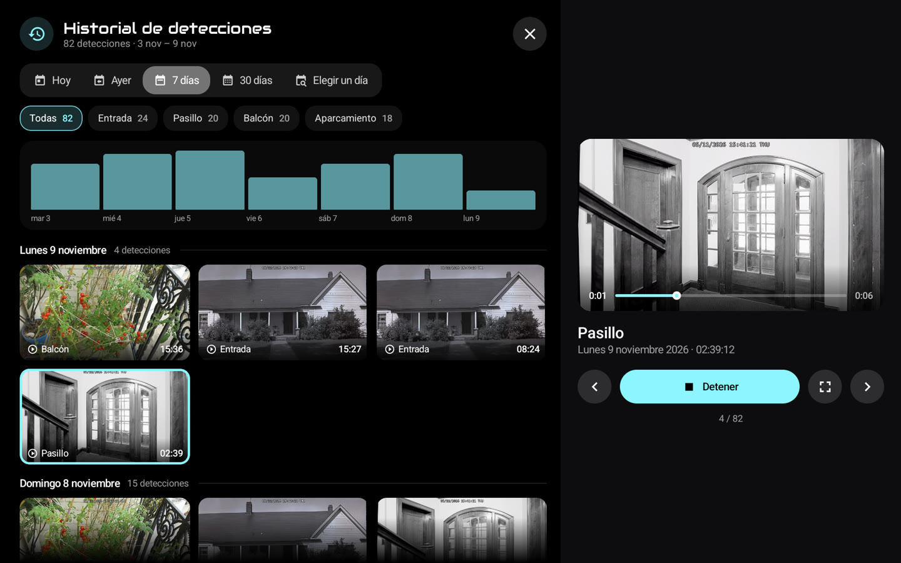

# 🏠 HA-MACS Android

[English](README.md) · [Français](README.fr.md) · [Deutsch](README.de.md) · **Español** · [Italiano](README.it.md) · [Nederlands](README.nl.md) · [Português](README.pt.md) · [Polski](README.pl.md)

Un **panel Android nativo para Home Assistant**, pensado para tablets de pared. Recupera el aspecto de un panel
Lovelace en modo quiosco en una app Jetpack Compose fluida, incluso en tablets modestas: sin navegador, sin tarjetas
personalizadas y sin nada que configurar en Home Assistant.

<p align="center">
  
  
</p>
<p align="center">
  
  
</p>
<p align="center">
  
  
</p>
<p align="center">
  
  
</p>
<p align="center">📸 <em>Datos de demostración.</em></p>

## ✨ Funciones

- 🤖 **M.A.C.S.**, el personaje animado, en el centro de la pantalla de inicio, con la hora y un breve parte meteorológico; sus ojos siguen tu dedo
- 🧙 **Asistente de configuración**: habitaciones, miembros, cámaras y elementos principales detectados en Home
  Assistant
- 🏠 **Habitaciones**: luces, temperatura, humedad y aparatos de un vistazo
- 👨‍👩‍👧 **Miembros**: presencia (toca la barra para ver llegadas y salidas), hora de llegada, pasos, batería del
  teléfono y próximos eventos
- 🧑‍🎨 **Avatares**: foto con la cámara de la tablet, un archivo o un teléfono (código QR), recortada en el dispositivo,
  filtros opcionales, la cabeza sobresale de un círculo con el color del panel
- 📹 **Cámaras**: directo, pestañas personalizables, pantalla completa en alta definición con zoom, últimas detecciones y
  su historial (medios de HA, SMB, NFS, local); la pantalla completa se cierra sola tras un tiempo (Ajustes › Pantalla),
  nunca durante una detección
  ; 🧱 **muro de cámaras**: cuadrícula por pestaña o todas, desde las pestañas, la pantalla de inicio o el mosaico «+N»,
  directo según la alimentación (red, solar, batería); un timbre puede abrir su cámara en grande con otras en miniatura
- 🚨 **Alertas**: versión nativa de [AlertTicker Card](https://github.com/djdevil/AlertTicker-Card), 63 temas, sonido,
  síntesis de voz y notificaciones
- 🌦️ **Tiempo y gráficos**: previsión, radar Windy, consumo eléctrico, precios del combustible con la gasolinera más
  barata (toca un gráfico: cada gasolinera, su precio y sus últimos cambios)
- 🎵 **Música**: carátula y sus colores, progreso en directo, volumen, aleatorio y repetición, varios reproductores;
  toca la carátula para la biblioteca, la búsqueda, la cola, la fuente y los altavoces
- 🎙️ **Asistente de voz**: habla con M.A.C.S. a través de tu pasarela local o como **satélite de voz de Home Assistant**
  (Wyoming, canalización de Assist, palabra de activación opcional); Ajustes › Asistente de voz
- ✏️ **Modo edición**: cambia entidades, habitaciones, pestañas y bloques directamente en la tablet
- 🔒 **Modo quiosco**: nadie sale de la app ni apaga la tablet sin el código maestro (o el de acceso)
- 🌍 **8 idiomas**: inglés, francés, alemán, español, italiano, neerlandés, portugués, polaco

> 💡 **Ningún sensor que crear en Home Assistant**: presencia, día/noche, avisos meteorológicos, mejor precio… la app
> lo calcula todo a partir de las entidades de tus integraciones.

## 📋 Requisitos

- 📱 Tablet con **Android 8.0** o posterior (p. ej. Galaxy Tab A8)
- 🏡 Home Assistant accesible desde la tablet; ningún token que crear: el asistente inicia sesión con tu cuenta,
  *Con el teléfono* (código QR, el gestor de contraseñas del teléfono rellena los campos) o *En la tableta*, o usa un
  *Token de acceso*

## 🚀 Instalación

Descarga el APK de la [última Release](https://github.com/Arubinu/ha-macs-android/releases/latest) (`…-arm64-v8a.apk` para casi todas las tabletas recientes) e
instálalo: después la app se actualiza sola. Para compilarlo tú mismo desde el código fuente:

```sh
# Se necesitan Android SDK (plataforma 36) y JDK 17
./gradlew assembleDebug
adb install -r app/build/outputs/apk/debug/app-debug.apk
```

En el primer arranque, el **asistente** encuentra Home Assistant en la red, inicia sesión y adapta el panel a tu casa.
¿Ya tienes una copia de seguridad? **Impórtala** en el primer paso y listo.

## 🍓 Raspberry Pi

Una Raspberry Pi 4 o 5 con pantalla táctil es un buen panel de pared. Primero hay que instalarle Android:

1. 📥 **LineageOS** (Android sin los servicios de Google): en la web de KonstaKANG, abre la página de la [Pi 4](https://konstakang.com/devices/rpi4/) o
   de la [Pi 5](https://konstakang.com/devices/rpi5/), elige la versión de LineageOS más reciente (no «Android TV») y descarga su `.zip` (sección
   *Download*). Solo la última versión está enlazada directamente; las anteriores están en *Previous builds*.
2. 💾 **Tarjeta microSD**: instala [Raspberry Pi Imager](https://www.raspberrypi.com/software/), elige tu modelo de Pi y, en la lista de sistemas, la
   última opción, *Use custom* (imagen personalizada): selecciona el `.zip` descargado y luego la tarjeta.
3. 📲 **La app**: arranca la Pi, termina la configuración de Android y descarga `…-arm64-v8a.apk` de la
   [última Release](https://github.com/Arubinu/ha-macs-android/releases/latest) con el navegador de la Pi (permite instalar aplicaciones desconocidas).

Una webcam USB se elige en Ajustes › Reposo y presencia › *Cámara*. Sin los servicios de Google, el recorte de los
avatares es algo menos preciso. Detalles: [referencia técnica](docs/reference.fr.md#raspberry-pi) (en francés).

⚡ **Alimentación**: usa la fuente oficial (5,1 V / 3 A para la Pi 4, 5 V / 5 A para la Pi 5). La Pi no negocia
USB Power Delivery: el puerto de un dock o de un cargador suele quedarse corto, sobre todo con webcams USB. Cuando la
tensión baja (señal HDMI perdida, lentitud), la app muestra *Alimentación insuficiente* abajo de la pantalla.

## ⚙️ En el día a día

- ⚙️ **Ajustes**: pulsación larga en la esquina superior izquierda (conexión, pantalla, reposo, código de acceso,
  idioma…)
- 🔑 **Código maestro** (opcional, en el asistente o en Ajustes › Seguridad): se pide antes de abrir los ajustes
- ✏️ **Modo edición**: Ajustes › Panel › *Editar los bloques*, y toca un bloque para cambiarlo
- 💾 **Copia de seguridad**: Ajustes › Panel › *Exportar* / *Importar* / *Con el teléfono* (código QR); el token y los
  códigos están cifrados para esta tableta (en otra se piden códigos nuevos), pero el archivo sigue siendo personal
  (diseño, fotos de los avatares)
- 🔄 **Actualizaciones**: Ajustes › Acerca de › *Actualizaciones*; las nuevas versiones (y las preliminares si se
  desea) se instalan solas, la app se vuelve a abrir tras una actualización o un fallo y muestra una vez las *Novedades*
- 🌙 **Modo noche**: Ajustes › Reposo y presencia › *Modo noche*; de la puesta de sol al amanecer (o a horas fijas),
  la pantalla se pone negra antes y se enciende con un toque o una presencia
- 🔔 **Timbre**: en modo edición, *Abrir con un evento* de una cámara la muestra a pantalla completa cuando un timbre
  o un detector se activa, con un sonido
- 📡 **Tableta en Home Assistant**: Ajustes › Home Assistant; sensores de batería, pantalla y presencia, y
  notificaciones (banner, lectura en voz alta, encendido de la pantalla, cámara a pantalla completa)
- 🔊 **Reproductor multimedia**: Home Assistant encuentra la tableta (DLNA) y puede reproducir en ella síntesis de voz,
  radios o Music Assistant; Ajustes › Home Assistant
  (acceso: Home Assistant y dispositivos aprobados, o toda la red)
- 🌍 **Acceso por Internet**: proxy inverso https (Pangolin, Cloudflare Access…) con sus cabeceras; Ajustes ›
  Home Assistant › *Proxy inverso*
- 🧙 **Asistente**: se puede volver a lanzar desde Ajustes › Panel

## 🔒 Modo quiosco

Ajustes › Seguridad › **Modo quiosco**. Para un bloqueo completo (Inicio, aplicaciones recientes, notificaciones y
menú de apagado bloqueados), convierte la app en *propietaria del dispositivo* una sola vez, desde un ordenador y sin
ninguna cuenta conectada en la tablet:

```sh
adb shell dpm set-device-owner fr.pergens.hamacs/.kiosk.KioskAdmin
```

📷 Sin ordenador: *Preparar la tableta* (abajo) muestra un código QR para escanear en la pantalla de bienvenida tras
un restablecimiento (6 toques en el mismo sitio). Más sencillo: elegir la app como pantalla de inicio; vuelve con el
botón Inicio y al arrancar, pero un gesto de Android puede quitar la fijación de pantalla.

🔁 Como propietaria, la app también puede reiniciar el dispositivo: Ajustes › Seguridad › *Reiniciar el dispositivo*
(Android no permite que una app lo apague).

⚠️ Antes de desinstalar: Ajustes › Seguridad › *Quitar los derechos de propietario*.

✅ Ajustes › Seguridad › *Preparar la tableta* lo comprueba todo de una vez: quiosco, propietario o pantalla de
inicio, código maestro, reapertura tras un fallo, batería y animaciones, cada uno con su solución.

## 🎙️ Asistente de voz (opcional)

Una pequeña pasarela en Python (`gateway/`, lista para Docker) envía el micrófono de la tablet a un modelo de audio
local (LFM3-Audio con llama-server) y ejecuta las acciones de Home Assistant. Las órdenes sencillas («enciende la luz
del salón») se ejecutan al instante, sin el modelo.

```sh
cd gateway && docker compose up -d
```

## 🛠️ Para ir más lejos

- ❓ [FAQ](docs/faq.md) (en inglés): tabletas compatibles, Raspberry Pi, cámaras, actualizaciones, problemas
- 🐛 ¿Algún problema? Ajustes › Acerca de › *Registro de fallos*: cópielo en un [informe](https://github.com/Arubinu/ha-macs-android/issues/new/choose)
- 📖 [Referencia técnica](docs/reference.fr.md) (en francés): `dashboard.json`, tipos de tarjetas, detecciones,
  AlertTicker, modo edición, pasarela de voz

## 📄 Licencia

El código está bajo [licencia MIT](LICENSE). Los recursos de terceros conservan su propia licencia:

- 🤖 [M.A.C.S.](https://github.com/glyndavidson/MACS) de Glyn Davidson y
  [hass-hue-icons](https://github.com/arallsopp/hass-hue-icons): **CC BY-NC-SA 4.0**, solo uso no comercial
- 🎨 [Material Design Icons](https://pictogrammers.com/library/mdi/) (Apache 2.0),
  [Meteocons](https://github.com/basmilius/weather-icons) (MIT), fuentes Audiowide y
  [Carlito](https://github.com/googlefonts/carlito) (OFL), temas y traducciones de
  [AlertTicker Card](https://github.com/djdevil/AlertTicker-Card) (MIT)
- 📚 [smbj](https://github.com/hierynomus/smbj) y [nfs-client-java](https://github.com/EMCECS/nfs-client-java)
  (Apache 2.0)
