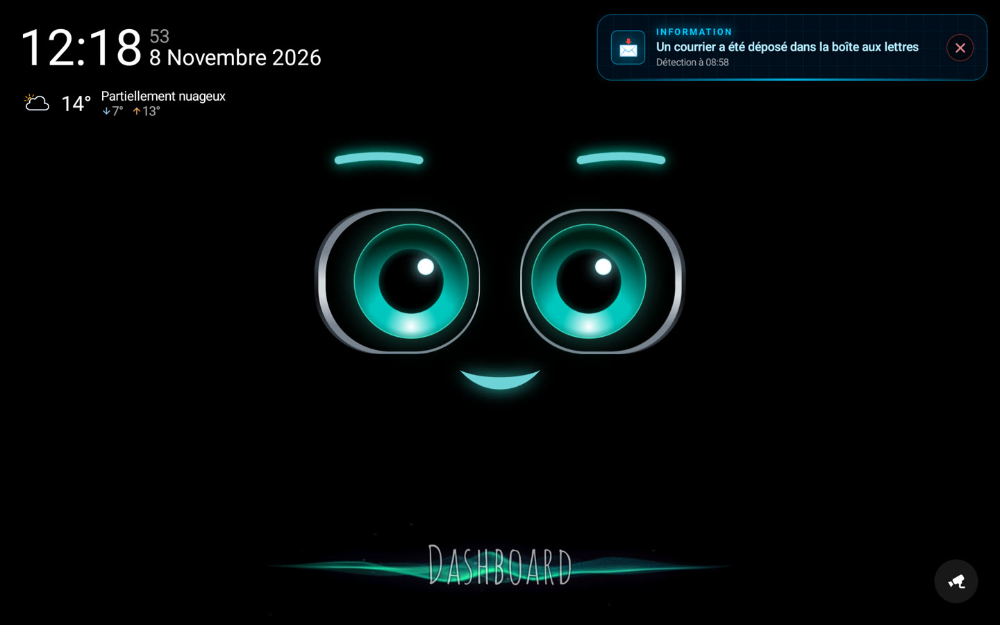
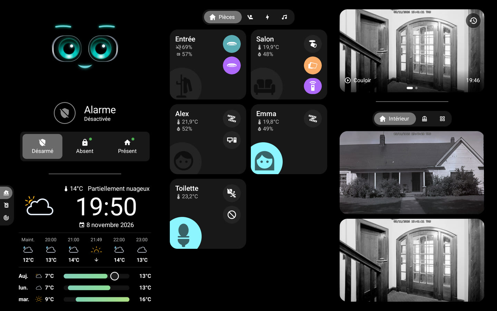
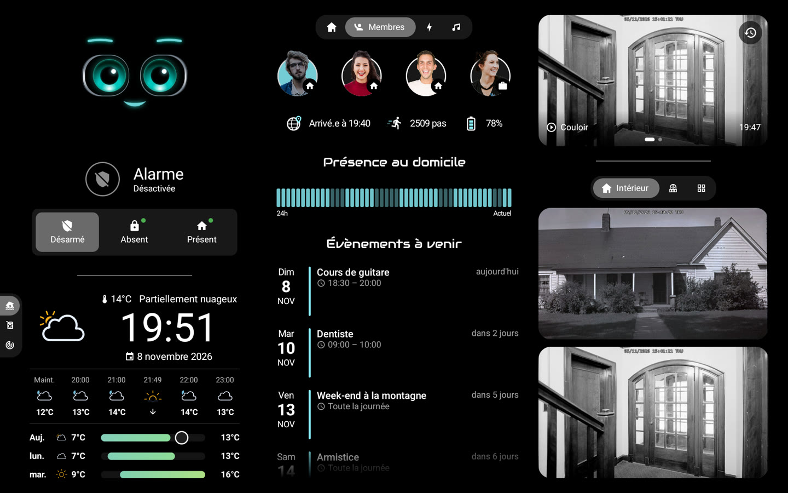
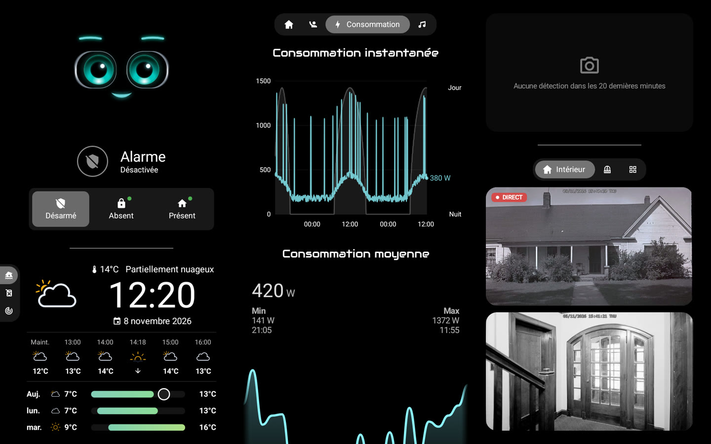
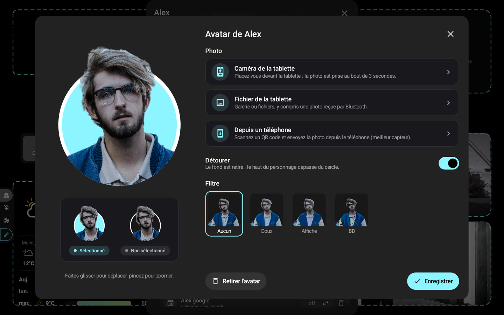

# 🏠 HA-MACS Android

[English](README.md) · **Français** · [Deutsch](README.de.md) · [Español](README.es.md) · [Italiano](README.it.md) · [Nederlands](README.nl.md) · [Português](README.pt.md) · [Polski](README.pl.md)

Un **tableau de bord Android natif pour Home Assistant**, pensé pour les tablettes murales. Il reprend l'apparence
d'un dashboard Lovelace en mode kiosque dans une app Jetpack Compose fluide, même sur une tablette modeste : sans
navigateur, sans cartes personnalisées et sans rien à configurer dans Home Assistant.

<p align="center">
  
  
</p>
<p align="center">
  
  
</p>
<p align="center">
  
</p>
<p align="center">📸 <em>Données de démonstration.</em></p>

## ✨ Fonctionnalités

- 🤖 **M.A.C.S.**, le personnage animé, au cœur de l'écran d'accueil
- 🧙 **Assistant de configuration** : pièces, membres, caméras et éléments principaux détectés dans Home Assistant
- 🏠 **Pièces** : lumières, température, humidité et appareils d'un coup d'œil
- 👨‍👩‍👧 **Membres** : présence, heure d'arrivée, pas, batterie du téléphone et événements à venir
- 🧑‍🎨 **Avatars** : photo prise avec la tablette, un fichier ou un téléphone (QR code), détourée sur l'appareil,
  filtres au choix, tête qui dépasse d'un cercle aux couleurs du tableau de bord
- 📹 **Caméras** : direct, onglets personnalisables, plein écran en haute définition, dernières détections (média HA,
  SMB, NFS, stockage local)
- 🚨 **Alertes** : portage natif de l'[AlertTicker Card](https://github.com/djdevil/AlertTicker-Card), 63 thèmes, son,
  synthèse vocale et notifications
- 🌦️ **Météo et graphiques** : prévisions, radar Windy, consommation électrique, prix des carburants avec la station la
  moins chère
- 🎙️ **Assistant vocal local** (facultatif) : parlez à M.A.C.S., qui répond grâce à un modèle audio local
- ✏️ **Mode édition** : entités, pièces, onglets et blocs se modifient directement sur la tablette
- 🔒 **Mode kiosque** : impossible de quitter l'app ou d'éteindre la tablette sans le code maître (ou le code d'accès)
- 🌍 **8 langues** : anglais, français, allemand, espagnol, italien, néerlandais, portugais, polonais

> 💡 **Aucun capteur à créer dans Home Assistant** : présence, jour/nuit, vigilance météo, meilleur prix… tout est
> calculé par l'app à partir des entités de vos intégrations.

## 📋 Prérequis

- 📱 Tablette **Android 8.0** ou plus récente (ex. Galaxy Tab A8)
- 🏡 Home Assistant joignable depuis la tablette, et un **jeton d'accès longue durée** (Profil › Sécurité)

## 🚀 Installation

Aucun APK n'est encore publié : il faut le compiler depuis les sources.

```sh
# Android SDK (plateforme 36) et JDK 17 nécessaires
./gradlew assembleDebug
adb install -r app/build/outputs/apk/debug/app-debug.apk
```

Au premier lancement, l'**assistant** demande l'adresse de Home Assistant et le jeton, puis adapte le tableau de bord
à votre maison. Vous avez déjà une sauvegarde ? **Importez-la** dès la première étape, et c'est terminé.

> 🔑 Des valeurs facultatives dans `local.properties` (non versionné) préremplissent la connexion : `ha.url`,
> `ha.token`, `voice.url`.

## ⚙️ Au quotidien

- ⚙️ **Réglages** : appui long sur le coin supérieur gauche (connexion, affichage, veille, code d'accès, langue…)
- 🔑 **Code maître** (facultatif, dans l'assistant ou Réglages › Sécurité) : demandé avant d'ouvrir les réglages
- ✏️ **Mode édition** : Réglages › Tableau de bord › *Modifier les blocs*, puis touchez un bloc pour le modifier
- 💾 **Sauvegarde** : Réglages › Tableau de bord › *Exporter* / *Importer* (le fichier contient votre jeton : gardez-le
  en lieu sûr)
- 🧙 **Assistant** : relançable depuis Réglages › Tableau de bord

## 🔒 Mode kiosque

Réglages › Sécurité › **Mode kiosque**. Pour un verrouillage complet (Accueil, applications récentes, notifications et
menu d'alimentation bloqués), faites de l'app le *propriétaire de l'appareil*, une seule fois, depuis un ordinateur,
sans aucun compte connecté sur la tablette :

```sh
adb shell dpm set-device-owner fr.arubinu.hadash/.kiosk.KioskAdmin
```

⚠️ Avant de désinstaller : Réglages › Sécurité › *Retirer les droits de propriétaire*.

## 🎙️ Assistant vocal (facultatif)

Une petite passerelle Python (`gateway/`, prête pour Docker) transmet le micro de la tablette à un modèle audio local
(LFM3-Audio via llama-server) et exécute les actions Home Assistant. Les commandes simples (« allume la lumière du
salon ») sont traitées immédiatement, sans le modèle.

```sh
cd gateway && docker compose up -d
```

## 🛠️ Pour aller plus loin

- 📖 [Référence technique](docs/reference.fr.md) : `dashboard.json`, types de cartes, détections, AlertTicker, mode
  édition, passerelle vocale
- 🗂️ **Fichiers personnels** : tout ce qui est dans `private/assets/` (non versionné) remplace les assets de l'app au
  build, par exemple votre propre `dashboard.json`

## 📄 Licence

Le code est sous [licence MIT](LICENSE). Les ressources tierces gardent leur propre licence :

- 🤖 [M.A.C.S.](https://github.com/glyndavidson/MACS) de Glyn Davidson et
  [hass-hue-icons](https://github.com/arallsopp/hass-hue-icons) : **CC BY-NC-SA 4.0**, usage non commercial uniquement
- 🎨 [Material Design Icons](https://pictogrammers.com/library/mdi/) (Apache 2.0),
  [Meteocons](https://github.com/basmilius/weather-icons) (MIT), polices Audiowide et
  [Carlito](https://github.com/googlefonts/carlito) (OFL), thèmes et traductions de
  l'[AlertTicker Card](https://github.com/djdevil/AlertTicker-Card) (MIT)
- 📚 [smbj](https://github.com/hierynomus/smbj) et [nfs-client-java](https://github.com/EMCECS/nfs-client-java)
  (Apache 2.0)
