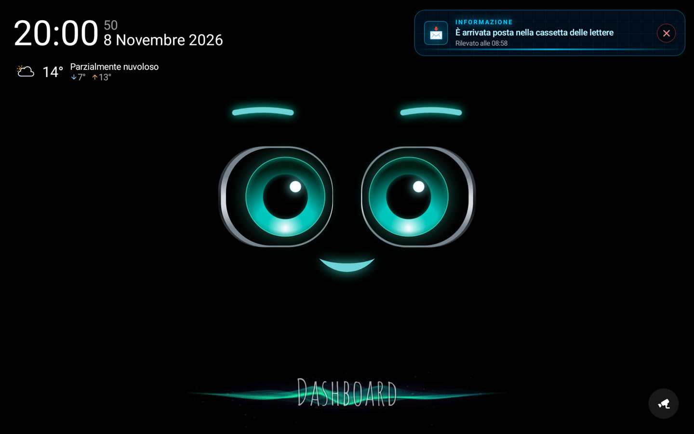
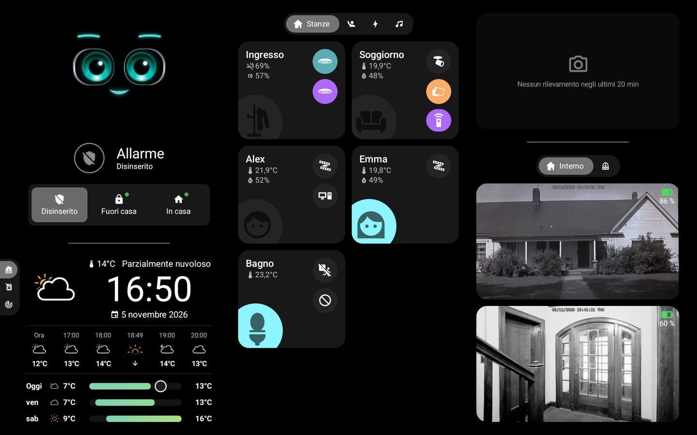
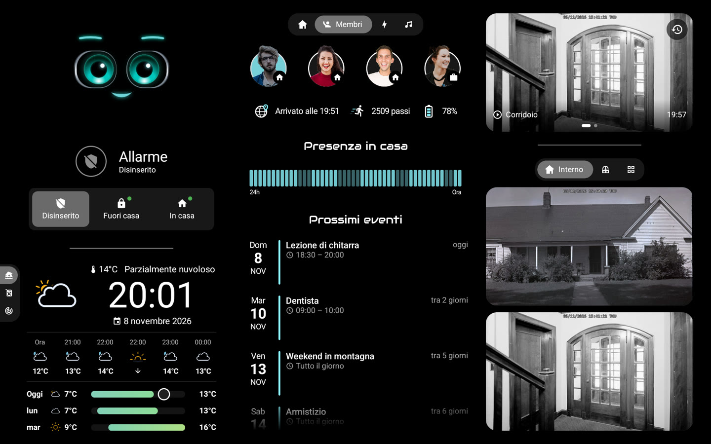
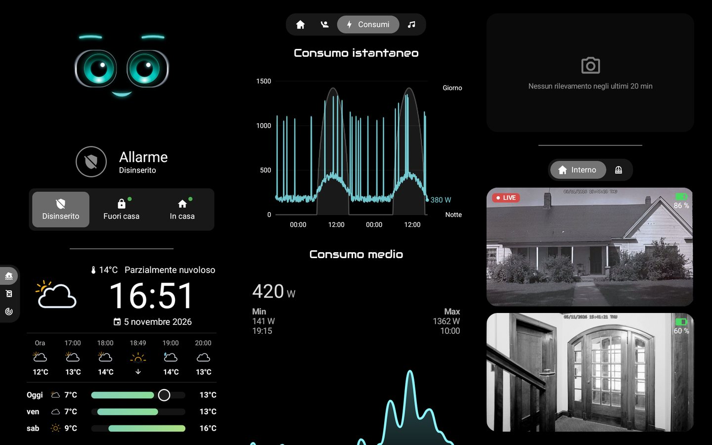
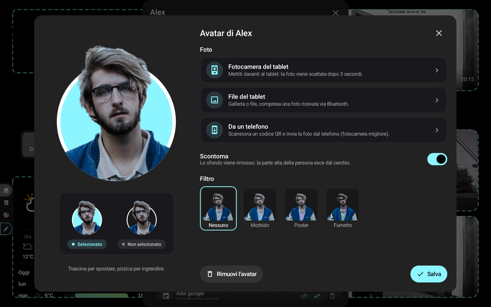
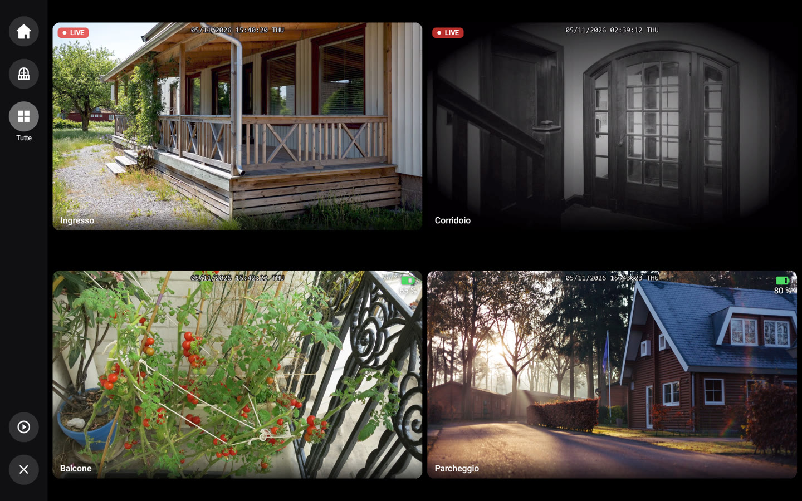
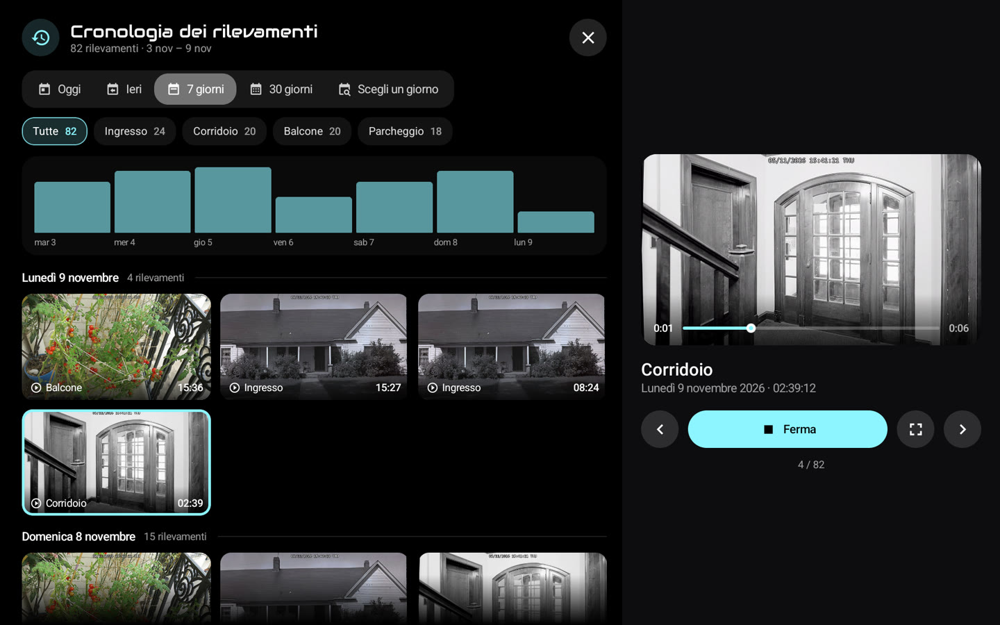
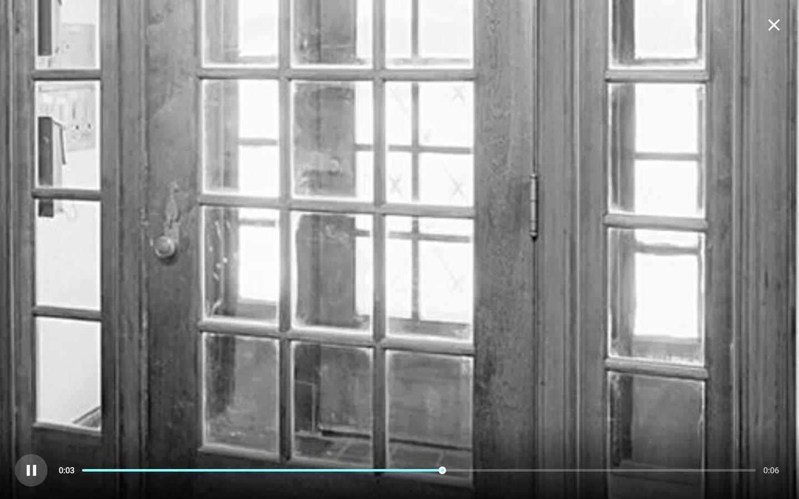

# 🏠 HA-MACS Android

[English](README.md) · [Français](README.fr.md) · [Deutsch](README.de.md) · [Español](README.es.md) · **Italiano** · [Nederlands](README.nl.md) · [Português](README.pt.md) · [Polski](README.pl.md)

Una **dashboard Android nativa per Home Assistant**, pensata per i tablet a parete. Riprende l'aspetto di una
dashboard Lovelace in modalità kiosk in un'app Jetpack Compose fluida, anche su tablet modesti: senza browser, senza
card personalizzate e senza nulla da configurare in Home Assistant.

<p align="center">
  
  
</p>
<p align="center">
  
  
</p>
<p align="center">
  
  
</p>
<p align="center">
  
  
</p>
<p align="center">📸 <em>Dati dimostrativi.</em></p>

## ✨ Funzionalità

- 🤖 **M.A.C.S.**, il personaggio animato, al centro della schermata iniziale, con l'ora e un meteo essenziale; i suoi occhi seguono il tuo dito
- 🧙 **Procedura guidata**: stanze, membri, telecamere ed elementi principali rilevati in Home Assistant
- 🏠 **Stanze**: luci, temperatura, umidità e dispositivi a colpo d'occhio
- 👨‍👩‍👧 **Membri**: presenza (tocca la barra per arrivi e partenze), ora di arrivo, passi, batteria del telefono e
  prossimi eventi
- 🧑‍🎨 **Avatar**: foto con la fotocamera del tablet, da un file o da un telefono (codice QR), scontornata sul
  dispositivo, filtri facoltativi, testa che esce da un cerchio con il colore della dashboard
- 📹 **Telecamere**: diretta, schede personalizzabili, schermo intero in alta definizione con zoom, ultimi rilevamenti e
  la loro cronologia (media HA, SMB, NFS, locale); lo schermo intero si chiude da solo dopo un tempo
  (Impostazioni › Visualizzazione), mai durante un rilevamento
  ; 🧱 **muro di telecamere**: griglia per scheda o tutte, dalle schede, dalla schermata iniziale o dal riquadro «+N»,
  diretta secondo l'alimentazione (rete, solare, batteria); un campanello può aprire la sua telecamera in grande con
  altre in miniatura
- 🚨 **Avvisi**: versione nativa di [AlertTicker Card](https://github.com/djdevil/AlertTicker-Card), 63 temi, suono,
  sintesi vocale e notifiche
- 🌦️ **Meteo e grafici**: previsioni, radar Windy, consumo elettrico, prezzi del carburante con il distributore più
  economico (tocca un grafico: ogni distributore, il suo prezzo e gli ultimi cambiamenti)
- 🎵 **Musica**: copertina e i suoi colori, avanzamento in diretta, volume, casuale e ripetizione, più lettori; tocca
  la copertina per libreria, ricerca, coda, sorgente e altoparlanti
- 🎙️ **Assistente vocale**: parla con M.A.C.S. tramite il tuo gateway locale o come **satellite vocale di Home Assistant**
  (Wyoming, pipeline Assist, parola di attivazione facoltativa); Impostazioni › Assistente vocale
- ✏️ **Modalità modifica**: entità, stanze, schede e blocchi si modificano direttamente sul tablet
- 🔒 **Modalità kiosk**: nessuno esce dall'app o spegne il tablet senza il codice principale (o quello di accesso)
- 🌍 **8 lingue**: inglese, francese, tedesco, spagnolo, italiano, olandese, portoghese, polacco

> 💡 **Nessun sensore da creare in Home Assistant**: presenza, giorno/notte, allerte meteo, prezzo migliore… l'app
> calcola tutto a partire dalle entità delle tue integrazioni.

## 📋 Requisiti

- 📱 Tablet con **Android 8.0** o successivo (es. Galaxy Tab A8)
- 🏡 Home Assistant raggiungibile dal tablet; nessun token da creare: la procedura accede con il tuo account,
  *Con il telefono* (codice QR, il gestore di password del telefono compila i campi) o *Sul tablet*, oppure usa un
  *Token di accesso*

## 🚀 Installazione

Scarica l'APK dell'[ultima Release](https://github.com/Arubinu/ha-macs-android/releases/latest) (`…-arm64-v8a.apk` per quasi tutti i tablet recenti) e installalo:
poi l'app si aggiorna da sola. Per compilarlo tu stesso dai sorgenti:

```sh
# Servono Android SDK (piattaforma 36) e JDK 17
./gradlew assembleDebug
adb install -r app/build/outputs/apk/debug/app-debug.apk
```

Al primo avvio, la **procedura guidata** trova Home Assistant sulla rete e accede, poi adatta la dashboard alla
tua casa. Hai già un backup? **Importalo** al primo passo e hai finito.

## 🍓 Raspberry Pi

Un Raspberry Pi 4 o 5 con touchscreen è un ottimo pannello a parete. Prima bisogna installarci Android:

1. 📥 **LineageOS** (Android senza i servizi Google): sul sito di KonstaKANG apri la pagina del [Pi 4](https://konstakang.com/devices/rpi4/) o del
   [Pi 5](https://konstakang.com/devices/rpi5/), scegli la versione di LineageOS più recente (non «Android TV») e scarica il suo `.zip` (sezione
   *Download*). Solo l'ultima versione è collegata direttamente; quelle precedenti sono in *Previous builds*.
2. 💾 **Scheda microSD**: installa [Raspberry Pi Imager](https://www.raspberrypi.com/software/), scegli il modello di Pi, poi nell'elenco dei sistemi
   l'ultima opzione, *Use custom* (immagine personalizzata): seleziona lo `.zip` scaricato, poi la scheda.
3. 📲 **L'app**: avvia il Pi, completa la configurazione di Android, poi scarica `…-arm64-v8a.apk` dall'
   [ultima Release](https://github.com/Arubinu/ha-macs-android/releases/latest) con il browser del Pi (consenti l'installazione di app sconosciute).

Una webcam USB si sceglie in Impostazioni › Standby e presenza › *Fotocamera*. Senza i servizi Google, il ritaglio
degli avatar è un po' meno preciso. Dettagli: [riferimento tecnico](docs/reference.md#raspberry-pi) (in inglese).

⚡ **Alimentazione**: usa l'alimentatore ufficiale (5,1 V / 3 A per il Pi 4, 5 V / 5 A per il Pi 5). Il Pi non negozia
l'USB Power Delivery: la porta di un dock o di un caricatore spesso non basta, soprattutto con webcam USB. Quando la
tensione cala (segnale HDMI perso, rallentamenti), l'app mostra *Alimentazione insufficiente* in fondo allo schermo.

## ⚙️ Nell'uso quotidiano

- ⚙️ **Impostazioni**: pressione prolungata sull'angolo in alto a sinistra (connessione, display, standby, codice di
  accesso, lingua…)
- 🔑 **Codice principale** (facoltativo, nella procedura guidata o in Impostazioni › Sicurezza): richiesto prima
  di aprire le impostazioni
- ✏️ **Modalità modifica**: Impostazioni › Dashboard › *Modifica i blocchi*, poi tocca un blocco per cambiarlo
- 💾 **Backup**: Impostazioni › Dashboard › *Esporta* / *Importa* / *Con il telefono* (codice QR); il token e i codici
  sono cifrati per questo tablet (su un altro vengono chiesti nuovi codici), ma il file resta personale (layout, foto
  degli avatar)
- 🔄 **Aggiornamenti**: Impostazioni › Informazioni › *Aggiornamenti*; le nuove versioni (e quelle preliminari se si
  vuole) si installano da sole, l'app si riapre dopo un aggiornamento o un arresto anomalo e mostra una volta le *Novità*
- 🌙 **Modalità notte**: Impostazioni › Standby e presenza › *Modalità notte*; dal tramonto all'alba (o a orari fissi)
  lo schermo diventa nero prima e si riaccende al tocco o a una presenza
- 🔔 **Campanello**: in modalità modifica, *Apri a un evento* di una telecamera la mostra a schermo intero quando un
  campanello o un sensore si attiva, con un suono
- 📡 **Tablet in Home Assistant**: Impostazioni › Home Assistant; sensori di batteria, schermo e presenza, e notifiche
  (banner, lettura ad alta voce, accensione dello schermo, telecamera a schermo intero)
- 🔊 **Lettore multimediale**: Home Assistant trova il tablet (DLNA) e può riprodurvi sintesi vocale, radio o Music
  Assistant; Impostazioni › Home Assistant
  (accesso: Home Assistant e dispositivi approvati, o tutta la rete)
- 🌍 **Accesso da Internet**: proxy inverso https (Pangolin, Cloudflare Access…) con le sue intestazioni;
  Impostazioni › Home Assistant › *Proxy inverso*
- 🧙 **Procedura guidata**: si può riavviare da Impostazioni › Dashboard

## 🔒 Modalità kiosk

Impostazioni › Sicurezza › **Modalità kiosk**. Per un blocco completo (Home, app recenti, notifiche e menu di
spegnimento bloccati), rendi l'app *proprietaria del dispositivo* una sola volta, da un computer, senza alcun account
collegato sul tablet:

```sh
adb shell dpm set-device-owner fr.pergens.hamacs/.kiosk.KioskAdmin
```

📷 Senza computer: *Preparare il tablet* (sotto) mostra un codice QR da scansionare nella schermata di benvenuto dopo
un ripristino (6 tocchi nello stesso punto). Più semplice: scegliere l'app come schermata Home; torna con il tasto Home
e all'avvio, ma un gesto di Android può togliere il blocco su schermo.

🔁 Da proprietaria, l'app può anche riavviare il dispositivo: Impostazioni › Sicurezza › *Riavvia il dispositivo*
(Android non permette a un'app di spegnerlo).

⚠️ Prima di disinstallare: Impostazioni › Sicurezza › *Rimuovi i diritti di proprietario*.

✅ Impostazioni › Sicurezza › *Preparare il tablet* controlla tutto in una volta: kiosk, proprietario o schermata
Home, codice principale, riapertura dopo un arresto, batteria e animazioni, ognuno con la sua soluzione.

## 🎙️ Assistente vocale (facoltativo)

Un piccolo gateway Python (`gateway/`, pronto per Docker) invia il microfono del tablet a un modello audio locale
(LFM3-Audio tramite llama-server) ed esegue le azioni di Home Assistant. I comandi semplici («accendi la luce del
soggiorno») vengono eseguiti subito, senza il modello.

```sh
cd gateway && docker compose up -d
```

## 🛠️ Per approfondire

- ❓ [FAQ](docs/faq.it.md): tablet compatibili, Raspberry Pi, telecamere, aggiornamenti, problemi
- 🐛 Un problema? Impostazioni › Informazioni › *Registro degli arresti anomali*: copialo in una [segnalazione](https://github.com/Arubinu/ha-macs-android/issues/new/choose)
- 📖 [Riferimento tecnico](docs/reference.md) (in inglese): `dashboard.json`, tipi di card, rilevamenti,
  AlertTicker, modalità modifica, gateway vocale

## 📄 Licenza

Il codice è sotto [licenza MIT](LICENSE). Le risorse di terze parti mantengono la propria licenza:

- 🤖 [M.A.C.S.](https://github.com/glyndavidson/MACS) di Glyn Davidson e
  [hass-hue-icons](https://github.com/arallsopp/hass-hue-icons): **CC BY-NC-SA 4.0**, solo uso non commerciale
- 🎨 [Material Design Icons](https://pictogrammers.com/library/mdi/) (Apache 2.0),
  [Meteocons](https://github.com/basmilius/weather-icons) (MIT), font Audiowide e
  [Carlito](https://github.com/googlefonts/carlito) (OFL), temi e traduzioni di
  [AlertTicker Card](https://github.com/djdevil/AlertTicker-Card) (MIT)
- 📚 [smbj](https://github.com/hierynomus/smbj) e [nfs-client-java](https://github.com/EMCECS/nfs-client-java)
  (Apache 2.0)
