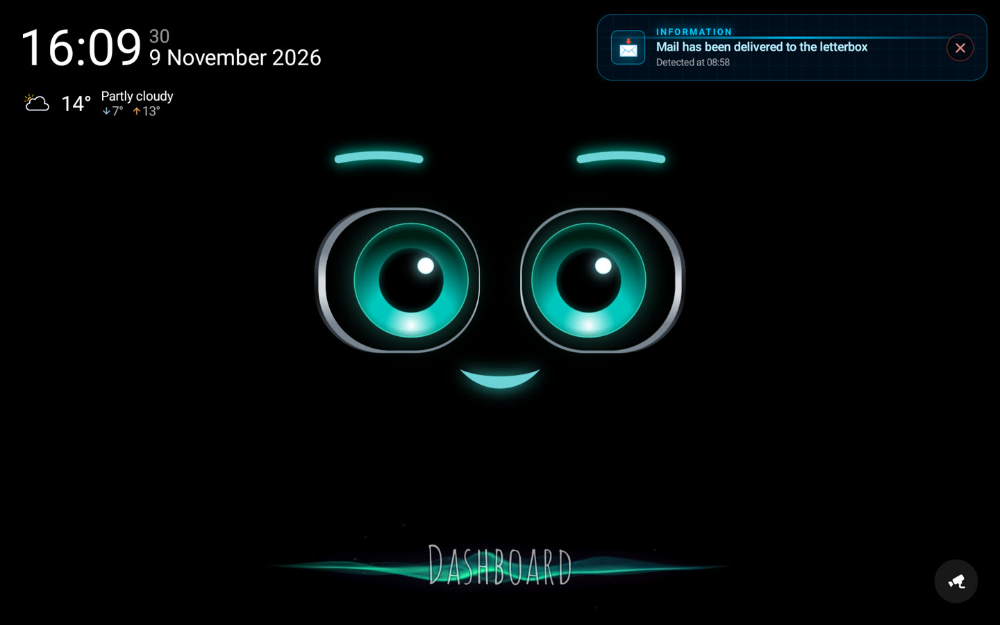
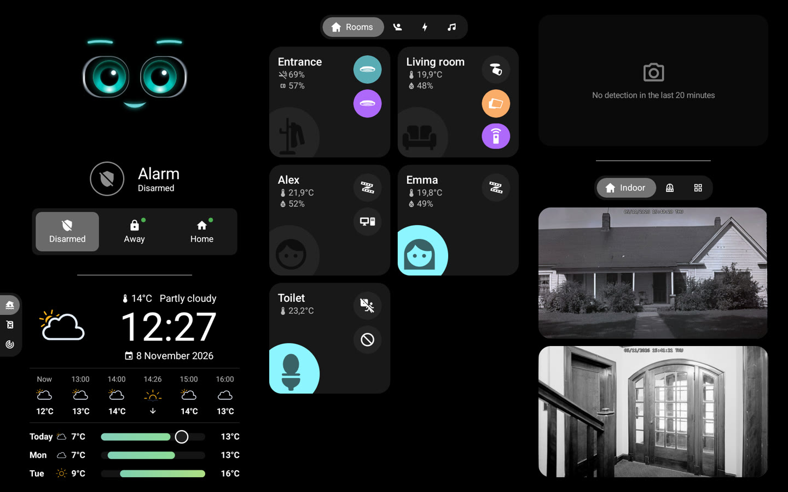
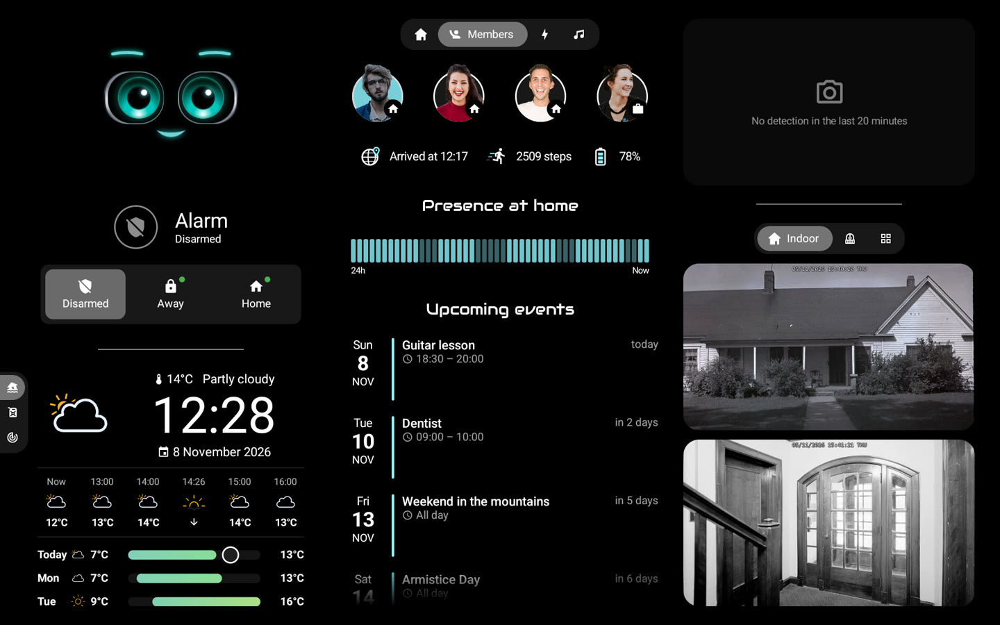
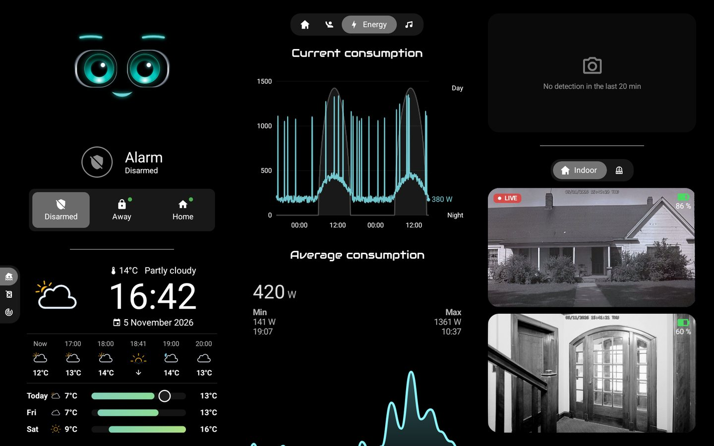
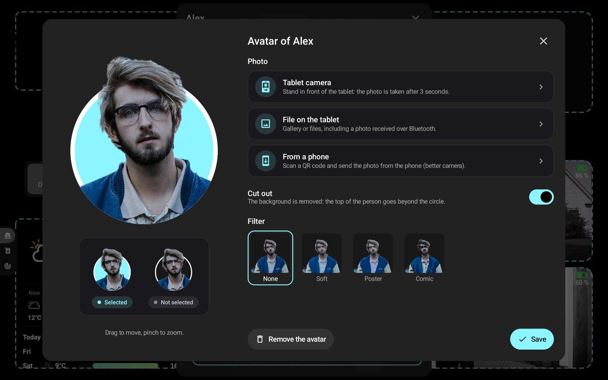

# 🏠 HA-MACS Android

**English** · [Français](README.fr.md) · [Deutsch](README.de.md) · [Español](README.es.md) · [Italiano](README.it.md) · [Nederlands](README.nl.md) · [Português](README.pt.md) · [Polski](README.pl.md)

A **native Android dashboard for Home Assistant**, made for wall-mounted tablets. It brings the look of a custom
Lovelace kiosk dashboard to a smooth Jetpack Compose app, even on modest tablets, with no browser, no custom cards and
nothing to set up in Home Assistant.

<p align="center">
  
  
</p>
<p align="center">
  
  
</p>
<p align="center">
  
</p>
<p align="center">📸 <em>Demo data.</em></p>

## ✨ Features

- 🤖 **M.A.C.S.**, the animated assistant character, at the heart of the home screen
- 🧙 **Setup wizard**: rooms, members, cameras and key elements are detected from your Home Assistant
- 🏠 **Rooms**: lights, temperature, humidity and devices at a glance
- 👨‍👩‍👧 **Members**: presence, arrival time, steps, phone battery and upcoming events
- 🧑‍🎨 **Avatars**: photo from the tablet camera, a file or a phone (QR code), cut out on the device, optional
  filters, head standing out of a circle that takes the dashboard colour
- 📹 **Cameras**: live view, custom tabs, fullscreen in high definition, latest detections (HA media, SMB, NFS, local)
- 🚨 **Alerts**: native port of [AlertTicker Card](https://github.com/djdevil/AlertTicker-Card), 63 themes, sound,
  speech and push notifications
- 🌦️ **Weather and graphs**: forecast, Windy radar, power consumption, fuel prices with the cheapest station
- 🎙️ **Local voice assistant** (optional): talk to M.A.C.S., answered by a local audio model
- ✏️ **Edit mode**: change entities, rooms, tabs and blocks right on the tablet
- 🔒 **Kiosk mode**: nobody leaves the app or turns the tablet off without the master code (or the access code)
- 🌍 **8 languages**: English, French, German, Spanish, Italian, Dutch, Portuguese, Polish

> 💡 **No sensor to create in Home Assistant**: presence, day/night, weather alerts, best price… everything is
> computed by the app from your integrations' entities.

## 📋 Requirements

- 📱 Android **8.0** or later tablet (e.g. Galaxy Tab A8)
- 🏡 Home Assistant reachable from the tablet; no token to create: the wizard signs in with your account,
  *With the phone* (QR code, the phone's password manager fills in the fields) or *On the tablet*, or takes an *Access token*

## 🚀 Installation

No APK is published yet: build it from the sources.

```sh
# Android SDK (platform 36) and JDK 17 required
./gradlew assembleDebug
adb install -r app/build/outputs/apk/debug/app-debug.apk
```

On first launch, the **wizard** finds Home Assistant on the network and signs in, then adapts the dashboard to your
home. Already have a backup? **Import** it on the first step and you are done.

> 🔑 Optional `local.properties` values (not versioned) prefill the connection: `ha.url`, `ha.token`, `voice.url`.

## ⚙️ Everyday use

- ⚙️ **Settings**: long press on the top-left corner (connection, display, sleep, access code, language…)
- 🔑 **Master code** (optional, in the wizard or Settings › Security): asked before opening the settings
- ✏️ **Edit mode**: Settings › Dashboard › *Edit blocks*, then touch any block to change it
- 💾 **Backup**: Settings › Dashboard › *Export* / *Import* / *With the phone* (QR code); the token and the codes are
  encrypted for this tablet (on another one, new codes are asked), but the file stays personal (layout, avatar photos)
- 🔄 **Updates**: Settings › About › *Updates*; new versions (and pre-releases if wanted) are installed
  automatically, the app reopens by itself after an update or a crash
- 🌙 **Night mode**: Settings › Standby & presence › *Night mode*; from sunset to sunrise (or set times), the
  screen goes black sooner and wakes on a touch or a presence
- 🔔 **Doorbell**: in edit mode, a camera's *Open on an event* shows it fullscreen when a doorbell or sensor
  triggers, with a sound
- 📡 **Tablet in Home Assistant**: Settings › Home Assistant; battery, screen and presence sensors, and
  notifications (banner, text read aloud, screen on, camera fullscreen)
- 🧙 **Wizard**: can be run again from Settings › Dashboard

## 🔒 Kiosk mode

Settings › Security › **Kiosk mode**. For a full lock (Home, recent apps, notifications and power menu blocked),
make the app *device owner* once, from a computer, with no account signed in on the tablet:

```sh
adb shell dpm set-device-owner fr.pergens.hamacs/.kiosk.KioskAdmin
```

⚠️ Before uninstalling: Settings › Security › *Remove device owner rights*.

## 🎙️ Voice assistant (optional)

A small Python gateway (`gateway/`, Docker ready) streams the tablet's microphone to a local audio model
(LFM3-Audio via llama-server) and runs the Home Assistant actions. Simple commands ("turn on the living room light")
are handled instantly without the model.

```sh
cd gateway && docker compose up -d
```

## 🛠️ Going further

- 📖 [Technical reference](docs/reference.fr.md) (in French): `dashboard.json`, card types, detections, AlertTicker,
  edit mode, voice gateway

## 📄 License

The code is under the [MIT license](LICENSE). Third-party resources keep their own licenses:

- 🤖 [M.A.C.S.](https://github.com/glyndavidson/MACS) by Glyn Davidson and
  [hass-hue-icons](https://github.com/arallsopp/hass-hue-icons): **CC BY-NC-SA 4.0**, non-commercial use only
- 🎨 [Material Design Icons](https://pictogrammers.com/library/mdi/) (Apache 2.0),
  [Meteocons](https://github.com/basmilius/weather-icons) (MIT), Audiowide and
  [Carlito](https://github.com/googlefonts/carlito) fonts (OFL),
  [AlertTicker Card](https://github.com/djdevil/AlertTicker-Card) themes and translations (MIT)
- 📚 [smbj](https://github.com/hierynomus/smbj) and [nfs-client-java](https://github.com/EMCECS/nfs-client-java)
  (Apache 2.0)
