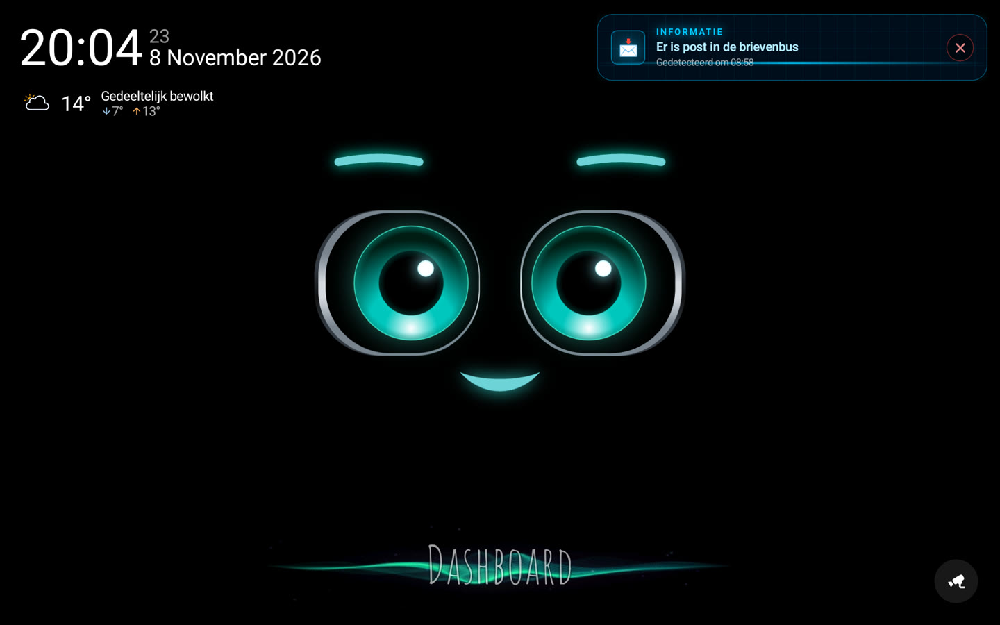
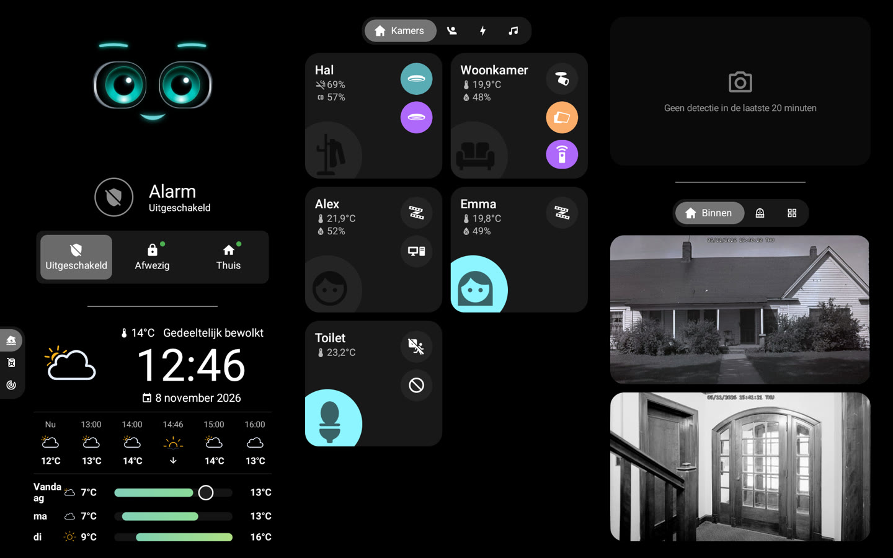
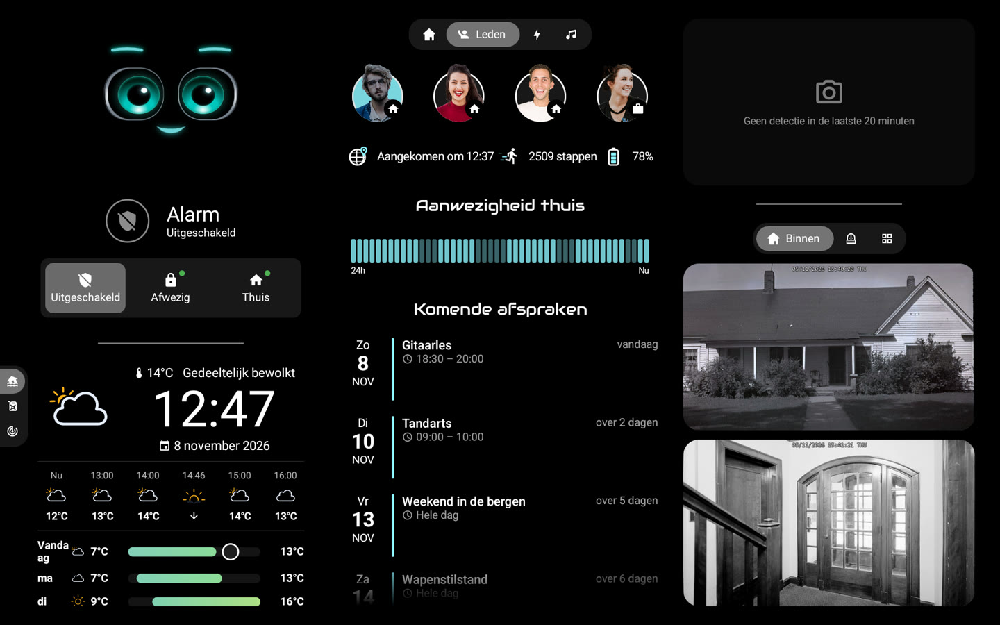
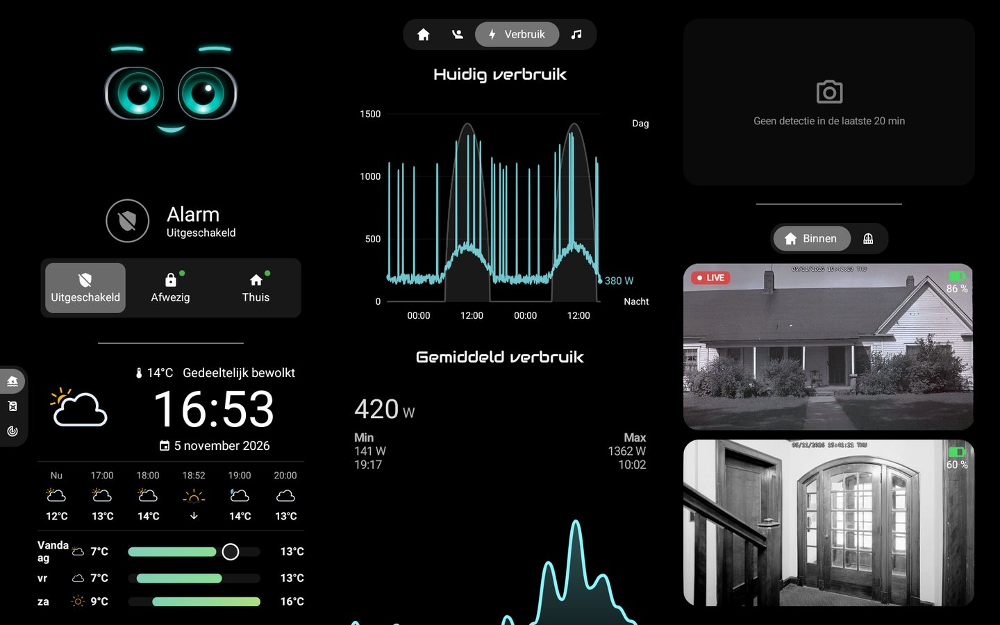
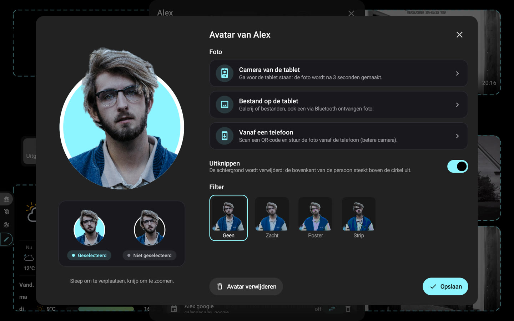

# 🏠 HA-MACS Android

[English](README.md) · [Français](README.fr.md) · [Deutsch](README.de.md) · [Español](README.es.md) · [Italiano](README.it.md) · **Nederlands** · [Português](README.pt.md) · [Polski](README.pl.md)

Een **native Android-dashboard voor Home Assistant**, gemaakt voor tablets aan de muur. Het brengt het uiterlijk van
een Lovelace-kioskdashboard naar een vloeiende Jetpack Compose-app, ook op eenvoudige tablets: zonder browser, zonder
custom cards en zonder iets in te stellen in Home Assistant.

<p align="center">
  
  
</p>
<p align="center">
  
  
</p>
<p align="center">
  
</p>
<p align="center">📸 <em>Demogegevens.</em></p>

## ✨ Functies

- 🤖 **M.A.C.S.**, het geanimeerde personage, centraal op het startscherm, met de tijd en een kort weerbericht
- 🧙 **Installatieassistent**: kamers, leden, camera's en belangrijke elementen worden in Home Assistant gevonden
- 🏠 **Kamers**: verlichting, temperatuur, luchtvochtigheid en apparaten in één oogopslag
- 👨‍👩‍👧 **Leden**: aanwezigheid (tik op de balk voor aankomsten en vertrekken), aankomsttijd, stappen, telefoonaccu en
  komende afspraken
- 🧑‍🎨 **Avatars**: foto met de tabletcamera, uit een bestand of vanaf een telefoon (QR-code), op het apparaat
  uitgeknipt, optionele filters, hoofd dat uit een cirkel in de dashboardkleur steekt
- 📹 **Camera's**: live beeld, eigen tabbladen, volledig scherm in hoge resolutie, laatste detecties (HA-media, SMB,
  NFS, lokaal)
- 🚨 **Meldingen**: native versie van [AlertTicker Card](https://github.com/djdevil/AlertTicker-Card), 63 thema's,
  geluid, spraak en pushmeldingen
- 🌦️ **Weer en grafieken**: verwachting, Windy-radar, stroomverbruik, brandstofprijzen met het goedkoopste tankstation
  (tik op een grafiek: elk tankstation, de prijs en de laatste wijzigingen)
- 🎵 **Muziek**: hoes en de kleuren ervan, voortgang live, volume, willekeurig en herhalen, meerdere spelers; tik op de
  hoes voor bibliotheek, zoeken, wachtrij, bron en speakers
- 🎙️ **Spraakassistent**: praat met M.A.C.S. via je lokale gateway of als **Home Assistant-spraaksatelliet** (Wyoming,
  Assist-pijplijn, activeringswoord optioneel); Instellingen › Spraakassistent
- ✏️ **Bewerkmodus**: entiteiten, kamers, tabbladen en blokken direct op de tablet aanpassen
- 🔒 **Kioskmodus**: niemand verlaat de app of zet de tablet uit zonder de mastercode (of de toegangscode)
- 🌍 **8 talen**: Engels, Frans, Duits, Spaans, Italiaans, Nederlands, Portugees, Pools

> 💡 **Geen sensor aan te maken in Home Assistant**: aanwezigheid, dag/nacht, weerwaarschuwingen, beste prijs… de app
> berekent alles uit de entiteiten van je integraties.

## 📋 Vereisten

- 📱 Tablet met **Android 8.0** of nieuwer (bijv. Galaxy Tab A8)
- 🏡 Home Assistant bereikbaar vanaf de tablet; geen token nodig: de wizard logt in met je account,
  *Met de telefoon* (QR-code, de wachtwoordbeheerder van de telefoon vult de velden in) of *Op de tablet*, of gebruikt
  een *Toegangstoken*

## 🚀 Installatie

Er is nog geen APK gepubliceerd: bouw hem vanuit de broncode.

```sh
# Android SDK (platform 36) en JDK 17 vereist
./gradlew assembleDebug
adb install -r app/build/outputs/apk/debug/app-debug.apk
```

Bij de eerste start vindt de **assistent** Home Assistant op het netwerk, logt in en past het dashboard aan je
huis aan. Heb je al een back-up? **Importeer** die bij de eerste stap en je bent klaar.

## ⚙️ Dagelijks gebruik

- ⚙️ **Instellingen**: lang drukken op de linkerbovenhoek (verbinding, weergave, slaapstand, toegangscode, taal…)
- 🔑 **Mastercode** (optioneel, in de wizard of Instellingen › Beveiliging): gevraagd voordat de instellingen opengaan
- ✏️ **Bewerkmodus**: Instellingen › Dashboard › *Blokken bewerken*, tik daarna op een blok om het te wijzigen
- 💾 **Back-up**: Instellingen › Dashboard › *Exporteren* / *Importeren* / *Met de telefoon* (QR-code); het token en de
  codes zijn versleuteld voor deze tablet (op een andere worden nieuwe codes gevraagd), maar het bestand blijft
  persoonlijk (indeling, avatarfoto's)
- 🔄 **Updates**: Instellingen › Over › *Updates*; nieuwe versies (en desgewenst voorlopige versies) worden automatisch
  geïnstalleerd, de app opent vanzelf opnieuw na een update of crash en toont één keer wat er *Nieuw* is
- 🌙 **Nachtmodus**: Instellingen › Stand-by & aanwezigheid › *Nachtmodus*; van zonsondergang tot zonsopkomst (of op
  vaste tijden) wordt het scherm sneller zwart en gaat het aan bij aanraking of aanwezigheid
- 🔔 **Deurbel**: in de bewerkmodus toont *Openen bij een gebeurtenis* een camera schermvullend wanneer een deurbel
  of sensor afgaat, met geluid
- 📡 **Tablet in Home Assistant**: Instellingen › Home Assistant; sensoren voor batterij, scherm en aanwezigheid, en
  meldingen (banner, voorlezen, scherm aan, camera schermvullend)
- 🔊 **Mediaspeler**: Home Assistant vindt de tablet (DLNA) en kan er tekst-naar-spraak, radio's of Music Assistant op
  afspelen; Instellingen › Home Assistant
  (toegang: Home Assistant en goedgekeurde apparaten, of het hele netwerk)
- 🌍 **Toegang via internet**: https-reverse proxy (Pangolin, Cloudflare Access…) met zijn headers;
  Instellingen › Home Assistant › *Reverse proxy*
- 🧙 **Assistent**: opnieuw te starten via Instellingen › Dashboard

## 🔒 Kioskmodus

Instellingen › Beveiliging › **Kioskmodus**. Voor een volledige vergrendeling (Home, recente apps, meldingen en
aan/uit-menu geblokkeerd) maak je de app eenmalig *apparaateigenaar*, vanaf een computer, zonder aangemeld account op de
tablet:

```sh
adb shell dpm set-device-owner fr.pergens.hamacs/.kiosk.KioskAdmin
```

📷 Zonder computer: *Tablet voorbereiden* (hieronder) toont een QR-code om na een reset op het welkomstscherm te
scannen (6 keer op dezelfde plek tikken). Eenvoudiger: kies de app als startscherm; ze komt terug met de Home-knop en
bij het opstarten, maar een Android-gebaar kan scherm vastzetten opheffen.

⚠️ Voor het verwijderen: Instellingen › Beveiliging › *Rechten van apparaateigenaar intrekken*.

✅ Instellingen › Beveiliging › *Tablet voorbereiden* controleert alles in één keer: kiosk, apparaateigenaar of
startscherm, mastercode, herstart na een crash, batterij en animaties, elk met de oplossing.

## 🎙️ Spraakassistent (optioneel)

Een kleine Python-gateway (`gateway/`, klaar voor Docker) stuurt de microfoon van de tablet naar een lokaal audiomodel
(LFM3-Audio via llama-server) en voert de Home Assistant-acties uit. Eenvoudige opdrachten („zet het licht in de
woonkamer aan") worden direct uitgevoerd, zonder het model.

```sh
cd gateway && docker compose up -d
```

## 🛠️ Verder lezen

- 📖 [Technische referentie](docs/reference.fr.md) (in het Frans): `dashboard.json`, kaarttypen, detecties,
  AlertTicker, bewerkmodus, spraakgateway

## 📄 Licentie

De code valt onder de [MIT-licentie](LICENSE). Bronnen van derden behouden hun eigen licentie:

- 🤖 [M.A.C.S.](https://github.com/glyndavidson/MACS) van Glyn Davidson en
  [hass-hue-icons](https://github.com/arallsopp/hass-hue-icons): **CC BY-NC-SA 4.0**, alleen niet-commercieel gebruik
- 🎨 [Material Design Icons](https://pictogrammers.com/library/mdi/) (Apache 2.0),
  [Meteocons](https://github.com/basmilius/weather-icons) (MIT), lettertypen Audiowide en
  [Carlito](https://github.com/googlefonts/carlito) (OFL), thema's en vertalingen van
  [AlertTicker Card](https://github.com/djdevil/AlertTicker-Card) (MIT)
- 📚 [smbj](https://github.com/hierynomus/smbj) en [nfs-client-java](https://github.com/EMCECS/nfs-client-java)
  (Apache 2.0)
