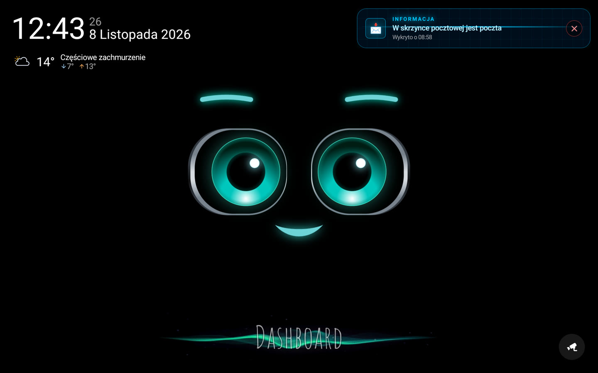
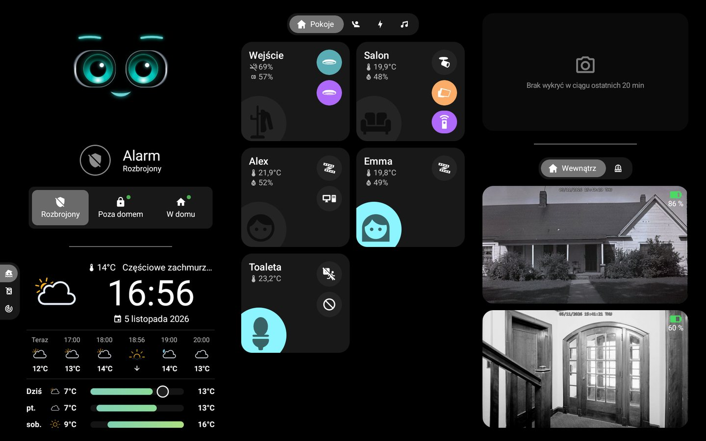
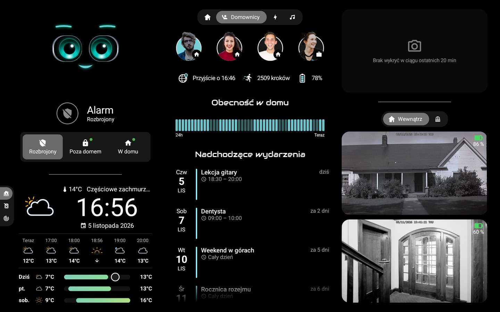
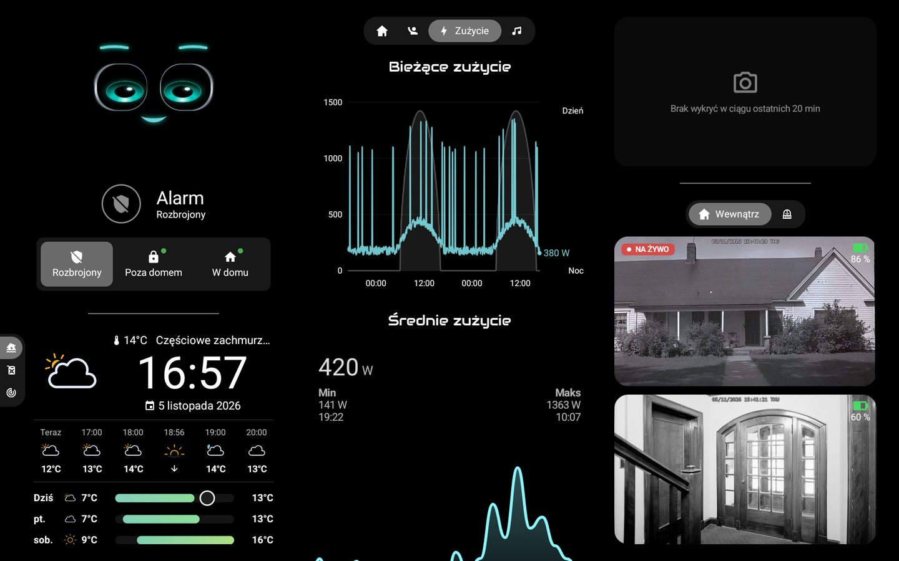
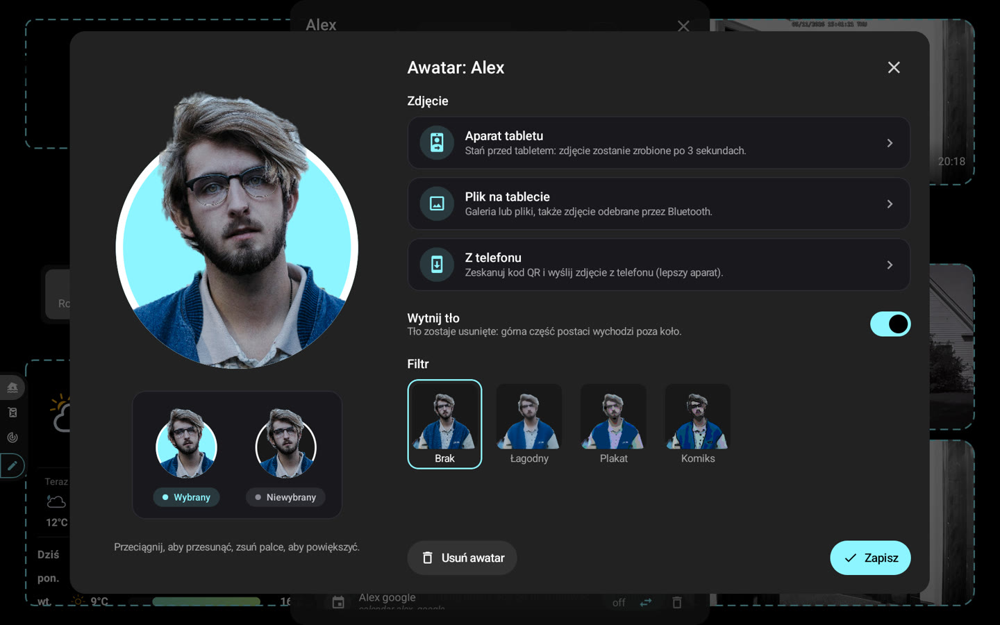
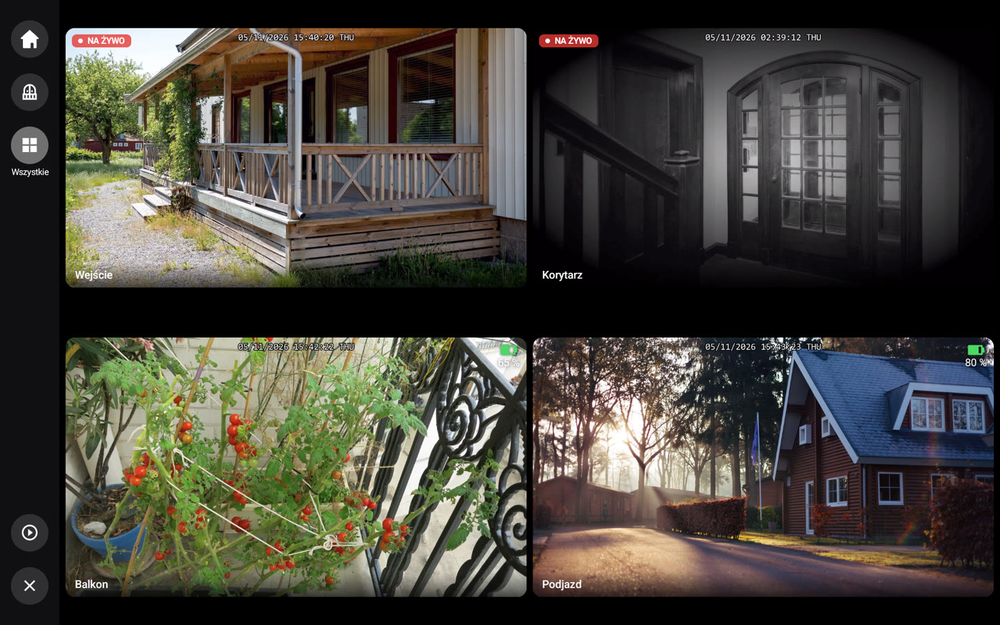
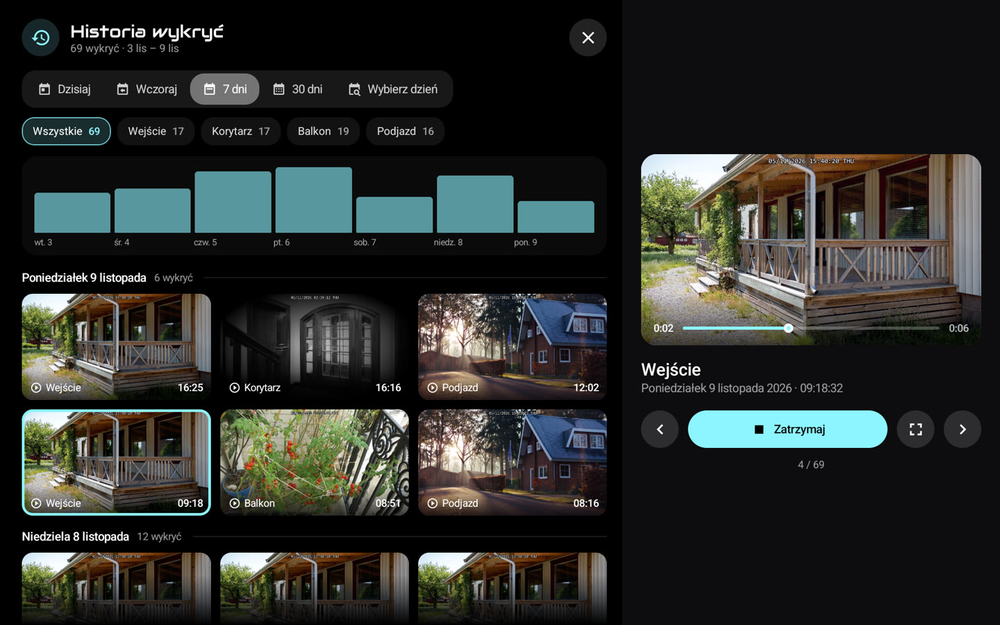

# 🏠 HA-MACS Android

[English](README.md) · [Français](README.fr.md) · [Deutsch](README.de.md) · [Español](README.es.md) · [Italiano](README.it.md) · [Nederlands](README.nl.md) · [Português](README.pt.md) · **Polski**

**Natywny pulpit Androida dla Home Assistant**, stworzony z myślą o tabletach na ścianie. Przenosi wygląd pulpitu
Lovelace w trybie kiosku do płynnej aplikacji Jetpack Compose, także na słabszych tabletach: bez przeglądarki, bez
niestandardowych kart i bez żadnej konfiguracji w Home Assistant.

<p align="center">
  
  
</p>
<p align="center">
  
  
</p>
<p align="center">
  
  
</p>
<p align="center">
  
  
</p>
<p align="center">📸 <em>Dane demonstracyjne.</em></p>

## ✨ Funkcje

- 🤖 **M.A.C.S.**, animowana postać, w centrum ekranu głównego, z godziną i krótką pogodą; jego oczy podążają za palcem
- 🧙 **Kreator konfiguracji**: pomieszczenia, domownicy, kamery i najważniejsze elementy wykrywane w Home Assistant
- 🏠 **Pomieszczenia**: światła, temperatura, wilgotność i urządzenia w jednym miejscu
- 👨‍👩‍👧 **Domownicy**: obecność (dotknij paska, aby zobaczyć przyjścia i wyjścia), godzina przybycia, kroki, bateria
  telefonu i nadchodzące wydarzenia
- 🧑‍🎨 **Awatary**: zdjęcie z aparatu tabletu, z pliku lub z telefonu (kod QR), wycięte z tła na urządzeniu,
  opcjonalne filtry, głowa wychodzi poza koło w kolorze pulpitu
- 📹 **Kamery**: podgląd na żywo, własne karty, pełny ekran w wysokiej rozdzielczości z powiększaniem, ostatnie wykrycia
  i ich historia (media HA, SMB, NFS, pamięć lokalna); pełny ekran zamyka się sam po czasie (Ustawienia › Wyświetlanie),
  nigdy podczas wykrycia
  ; 🧱 **ściana kamer**: siatka według karty lub wszystkie, z kart, ekranu głównego lub kafelka „+N”, na żywo zależnie
  od zasilania (sieć, słoneczne, bateria); dzwonek może otworzyć swoją kamerę w dużym oknie z innymi jako miniatury
- 🚨 **Alerty**: natywna wersja [AlertTicker Card](https://github.com/djdevil/AlertTicker-Card), 63 motywy, dźwięk,
  synteza mowy i powiadomienia
- 🌦️ **Pogoda i wykresy**: prognoza, radar Windy, zużycie prądu, ceny paliw z najtańszą stacją (dotknij wykresu: każda
  stacja, jej cena i ostatnie zmiany)
- 🎵 **Muzyka**: okładka i jej kolory, postęp na żywo, głośność, losowo i powtarzanie, kilka odtwarzaczy; dotknij
  okładki, aby otworzyć bibliotekę, wyszukiwanie, kolejkę, źródło i głośniki
- 🎙️ **Asystent głosowy**: rozmawiaj z M.A.C.S. przez lokalną bramkę lub jako **satelita głosowy Home Assistant**
  (Wyoming, potok Assist, opcjonalne słowo aktywujące); Ustawienia › Asystent głosowy
- ✏️ **Tryb edycji**: zmieniaj encje, pomieszczenia, karty i bloki bezpośrednio na tablecie
- 🔒 **Tryb kiosku**: bez kodu głównego (lub kodu dostępu) nikt nie wyjdzie z aplikacji ani nie wyłączy tabletu
- 🌍 **8 języków**: angielski, francuski, niemiecki, hiszpański, włoski, niderlandzki, portugalski, polski

> 💡 **Żadnych czujników do tworzenia w Home Assistant**: obecność, dzień/noc, ostrzeżenia pogodowe, najlepsza cena…
> aplikacja wylicza wszystko z encji Twoich integracji.

## 📋 Wymagania

- 📱 Tablet z **Androidem 8.0** lub nowszym (np. Galaxy Tab A8)
- 🏡 Home Assistant dostępny z tabletu; nie trzeba tworzyć tokenu: kreator loguje się na Twoje konto,
  *Telefonem* (kod QR, menedżer haseł telefonu wypełnia pola) lub *Na tablecie*, albo używa *Tokenu dostępu*

## 🚀 Instalacja

Pobierz plik APK z [najnowszego wydania](https://github.com/Arubinu/ha-macs-android/releases/latest) (`…-arm64-v8a.apk` dla prawie wszystkich nowych tabletów) i
zainstaluj go: potem aplikacja aktualizuje się sama. Aby zbudować ją samodzielnie ze źródeł:

```sh
# Wymagane Android SDK (platforma 36) i JDK 17
./gradlew assembleFullDebug    # lub assembleLiteDebug
adb install -r app/build/outputs/apk/full/debug/app-full-debug.apk
```

🪶 **Wersja lekka** `…-lite-universal.apk` (15 MB zamiast 50, wszystkie tablety): bez Google ML Kit i bez
zastrzeżonych komponentów; awatary to okrągłe zdjęcia (bez wycinania). Też aktualizuje się sama, pozostając lekka.

Przy pierwszym uruchomieniu **kreator** znajduje Home Assistant w sieci i loguje się, a następnie dopasowuje pulpit do Twojego
domu. Masz już kopię zapasową? **Zaimportuj** ją w pierwszym kroku i gotowe.

## 🍓 Raspberry Pi

Raspberry Pi 4 lub 5 z ekranem dotykowym to dobry panel ścienny. Najpierw trzeba zainstalować na nim Androida:

1. 📥 **LineageOS** (Android bez usług Google): na stronie KonstaKANG otwórz stronę [Pi 4](https://konstakang.com/devices/rpi4/) lub [Pi 5](https://konstakang.com/devices/rpi5/),
   wybierz najnowszą wersję LineageOS (nie „Android TV”) i pobierz jej plik `.zip` (sekcja *Download*). Bezpośrednio
   dostępna jest tylko najnowsza wersja; starsze są w *Previous builds*.
2. 💾 **Karta microSD**: zainstaluj [Raspberry Pi Imager](https://www.raspberrypi.com/software/), wybierz model Pi, a na liście systemów ostatnią
   opcję, *Use custom* (własny obraz): wskaż pobrany plik `.zip`, a potem kartę.
3. 📲 **Aplikacja**: uruchom Pi, dokończ konfigurację Androida i pobierz `…-arm64-v8a.apk` z
   [najnowszego wydania](https://github.com/Arubinu/ha-macs-android/releases/latest) w przeglądarce Pi (zezwól na instalowanie nieznanych aplikacji).

Kamerę USB wybiera się w Ustawienia › Czuwanie i obecność › *Kamera*. Bez usług Google wycinanie awatarów jest nieco
mniej dokładne. Szczegóły: [dokumentacja techniczna](docs/reference.md#raspberry-pi) (po angielsku).

⚡ **Zasilanie**: używaj oficjalnego zasilacza (5,1 V / 3 A dla Pi 4, 5 V / 5 A dla Pi 5). Pi nie negocjuje USB Power
Delivery: port stacji dokującej lub ładowarki często nie wystarcza, zwłaszcza z kamerami USB. Gdy napięcie spada
(utrata sygnału HDMI, spowolnienia), aplikacja pokazuje na dole ekranu *Zbyt słabe zasilanie*.

## ⚙️ Na co dzień

- ⚙️ **Ustawienia**: długie naciśnięcie lewego górnego rogu (połączenie, wyświetlanie, uśpienie, kod dostępu, język…)
- 🔑 **Kod główny** (opcjonalnie, w kreatorze lub Ustawienia › Bezpieczeństwo): wymagany przed otwarciem ustawień
- ✏️ **Tryb edycji**: Ustawienia › Panel › *Edytuj bloki*, a następnie dotknij bloku, aby go zmienić
- 💾 **Kopia zapasowa**: Ustawienia › Panel › *Eksportuj* / *Importuj* / *Telefonem* (kod QR); token i kody są
  zaszyfrowane dla tego tabletu (na innym wymagane są nowe kody), ale plik pozostaje osobisty (układ, zdjęcia
  awatarów)
- 🔄 **Aktualizacje**: Ustawienia › Informacje › *Aktualizacje*; nowe wersje (i na życzenie wersje wstępne) instalują
  się same, aplikacja otwiera się ponownie po aktualizacji lub awarii i raz pokazuje *Nowości*
- 🌙 **Tryb nocny**: Ustawienia › Czuwanie i obecność › *Tryb nocny*; od zachodu do wschodu słońca (lub w ustalonych
  godzinach) ekran szybciej robi się czarny i budzi się po dotyku lub wykryciu obecności
- 🔔 **Dzwonek**: w trybie edycji *Otwórz przy zdarzeniu* kamery pokazuje ją na pełnym ekranie, gdy uruchomi się dzwonek
  lub czujnik, z dźwiękiem
- 📡 **Tablet w Home Assistant**: Ustawienia › Home Assistant; czujniki baterii, ekranu i obecności oraz powiadomienia
  (baner, czytanie na głos, włączenie ekranu, kamera na pełnym ekranie)
- 🔊 **Odtwarzacz multimediów**: Home Assistant wykrywa tablet (DLNA) i może odtwarzać na nim syntezę mowy, radio lub
  Music Assistant; Ustawienia › Home Assistant
  (dostęp: Home Assistant i zatwierdzone urządzenia albo cała sieć)
- 🌍 **Dostęp przez Internet**: odwrotne proxy https (Pangolin, Cloudflare Access…) z jego nagłówkami;
  Ustawienia › Home Assistant › *Odwrotne proxy*
- 🧙 **Kreator**: można go uruchomić ponownie w Ustawienia › Panel

## 🔒 Tryb kiosku

Ustawienia › Bezpieczeństwo › **Tryb kiosku**. Aby uzyskać pełną blokadę (przycisk Home, ostatnie aplikacje,
powiadomienia i menu zasilania zablokowane), jednorazowo ustaw aplikację jako *właściciela urządzenia* z komputera, bez
żadnego zalogowanego konta na tablecie:

```sh
adb shell dpm set-device-owner fr.pergens.hamacs/.kiosk.KioskAdmin
```

📷 Bez komputera: *Przygotuj tablet* (poniżej) pokazuje kod QR do zeskanowania na ekranie powitalnym po przywróceniu
ustawień fabrycznych (6 dotknięć w tym samym miejscu). Prościej: wybrać aplikację jako ekran główny; wraca po
naciśnięciu przycisku ekranu głównego i przy starcie, ale gest Androida może zdjąć przypięcie ekranu.

🔁 Jako właściciel aplikacja może też ponownie uruchomić urządzenie: Ustawienia › Bezpieczeństwo › *Uruchom ponownie urządzenie*
(Android nie pozwala aplikacji go wyłączyć).

⚠️ Przed odinstalowaniem: Ustawienia › Bezpieczeństwo › *Usuń uprawnienia właściciela*.

✅ Ustawienia › Bezpieczeństwo › *Przygotuj tablet* sprawdza wszystko naraz: kiosk, właściciela urządzenia lub
ekran główny, kod główny, ponowne otwarcie po awarii, baterię i animacje, każde z rozwiązaniem.

## 🎙️ Asystent głosowy (opcjonalnie)

Niewielka bramka w Pythonie (`gateway/`, gotowa do Dockera) przesyła mikrofon tabletu do lokalnego modelu audio
(LFM3-Audio przez llama-server) i wykonuje akcje Home Assistant. Proste polecenia („włącz światło w salonie") są
wykonywane od razu, bez modelu.

```sh
cd gateway && docker compose up -d
```

## 🛠️ Więcej informacji

- ❓ [FAQ](docs/faq.pl.md): obsługiwane tablety, Raspberry Pi, kamery, aktualizacje, problemy
- 🐛 Problem? Ustawienia › Informacje › *Dziennik awarii*: skopiuj go do [zgłoszenia](https://github.com/Arubinu/ha-macs-android/issues/new/choose)
- 📖 [Dokumentacja techniczna](docs/reference.md) (po angielsku): `dashboard.json`, typy kart, wykrycia,
  AlertTicker, tryb edycji, bramka głosowa

## 📄 Licencja

Kod jest udostępniony na [licencji MIT](LICENSE). Zasoby zewnętrzne zachowują własne licencje:

- 🤖 [M.A.C.S.](https://github.com/glyndavidson/MACS) autorstwa Glyna Davidsona oraz
  [hass-hue-icons](https://github.com/arallsopp/hass-hue-icons): **CC BY-NC-SA 4.0**, wyłącznie do użytku
  niekomercyjnego
- 🎨 [Material Design Icons](https://pictogrammers.com/library/mdi/) (Apache 2.0),
  [Meteocons](https://github.com/basmilius/weather-icons) (MIT), czcionki Audiowide i
  [Carlito](https://github.com/googlefonts/carlito) (OFL), motywy i tłumaczenia
  [AlertTicker Card](https://github.com/djdevil/AlertTicker-Card) (MIT)
- 📚 [smbj](https://github.com/hierynomus/smbj) i [nfs-client-java](https://github.com/EMCECS/nfs-client-java)
  (Apache 2.0)
