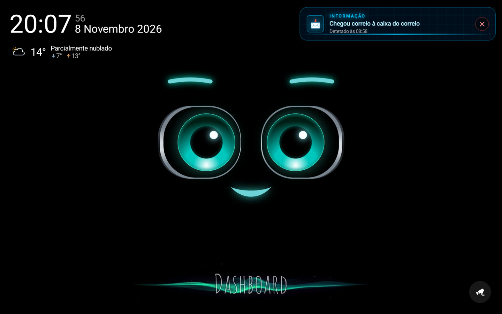
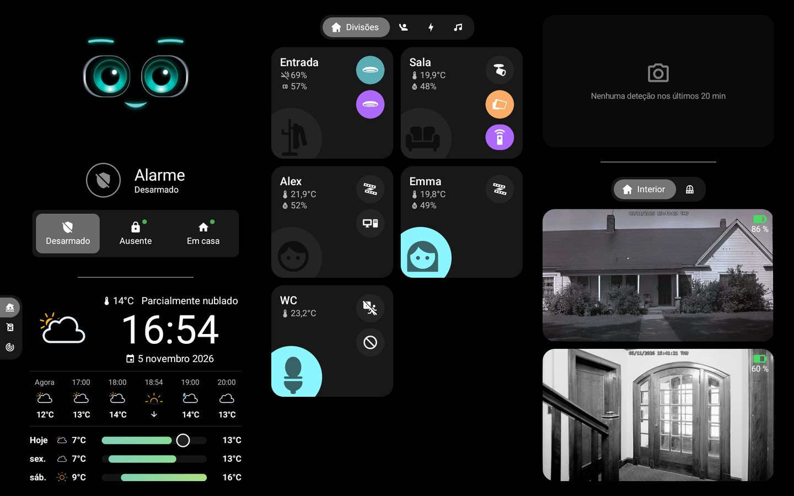
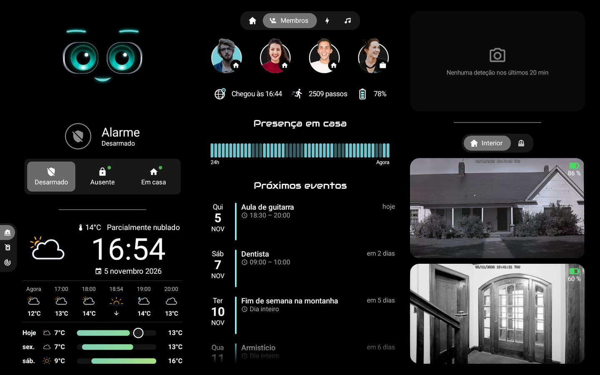
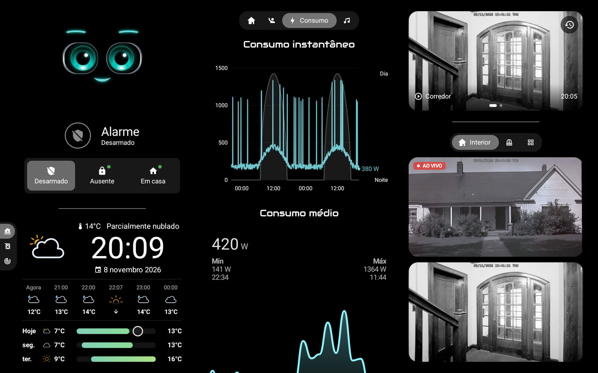
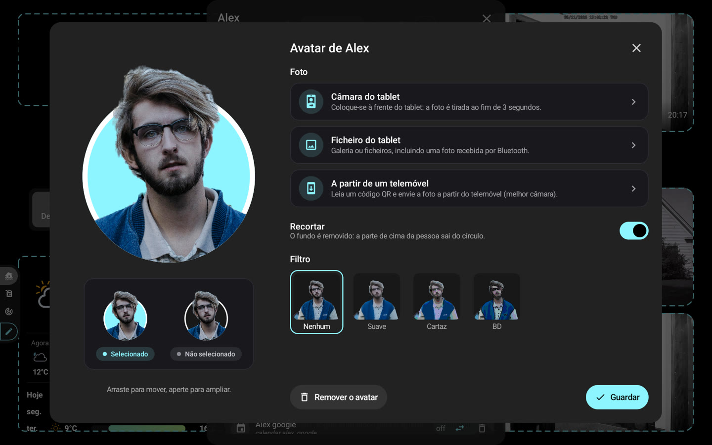

# 🏠 HA-MACS Android

[English](README.md) · [Français](README.fr.md) · [Deutsch](README.de.md) · [Español](README.es.md) · [Italiano](README.it.md) · [Nederlands](README.nl.md) · **Português** · [Polski](README.pl.md)

Um **painel Android nativo para o Home Assistant**, pensado para tablets de parede. Traz o aspeto de um painel
Lovelace em modo quiosque para uma app Jetpack Compose fluida, mesmo em tablets modestos: sem navegador, sem cartões
personalizados e sem nada para configurar no Home Assistant.

<p align="center">
  
  
</p>
<p align="center">
  
  
</p>
<p align="center">
  
</p>
<p align="center">📸 <em>Dados de demonstração.</em></p>

## ✨ Funcionalidades

- 🤖 **M.A.C.S.**, a personagem animada, no centro do ecrã inicial
- 🧙 **Assistente de configuração**: divisões, membros, câmaras e elementos principais detetados no Home Assistant
- 🏠 **Divisões**: luzes, temperatura, humidade e aparelhos num relance
- 👨‍👩‍👧 **Membros**: presença, hora de chegada, passos, bateria do telemóvel e próximos eventos
- 🧑‍🎨 **Avatares**: foto com a câmara do tablet, de um ficheiro ou de um telemóvel (código QR), recortada no
  dispositivo, filtros opcionais, cabeça a sair de um círculo com a cor do painel
- 📹 **Câmaras**: em direto, separadores personalizáveis, ecrã inteiro em alta definição, últimas deteções (multimédia
  do HA, SMB, NFS, local)
- 🚨 **Alertas**: versão nativa do [AlertTicker Card](https://github.com/djdevil/AlertTicker-Card), 63 temas, som,
  voz e notificações
- 🌦️ **Meteorologia e gráficos**: previsão, radar Windy, consumo elétrico, preços dos combustíveis com o posto mais
  barato
- 🎙️ **Assistente de voz local** (opcional): fale com o M.A.C.S., que responde através de um modelo de áudio local
- ✏️ **Modo de edição**: altere entidades, divisões, separadores e blocos diretamente no tablet
- 🔒 **Modo quiosque**: ninguém sai da app nem desliga o tablet sem o código mestre (ou o de acesso)
- 🌍 **8 idiomas**: inglês, francês, alemão, espanhol, italiano, neerlandês, português, polaco

> 💡 **Nenhum sensor para criar no Home Assistant**: presença, dia/noite, avisos meteorológicos, melhor preço… a app
> calcula tudo a partir das entidades das suas integrações.

## 📋 Requisitos

- 📱 Tablet com **Android 8.0** ou posterior (ex. Galaxy Tab A8)
- 🏡 Home Assistant acessível a partir do tablet e um **token de acesso de longa duração** (Perfil › Segurança)

## 🚀 Instalação

Ainda não há nenhum APK publicado: é preciso compilá-lo a partir do código-fonte.

```sh
# São necessários o Android SDK (plataforma 36) e o JDK 17
./gradlew assembleDebug
adb install -r app/build/outputs/apk/debug/app-debug.apk
```

No primeiro arranque, o **assistente** pede o endereço do Home Assistant e o token, e adapta o painel à sua casa. Já
tem uma cópia de segurança? **Importe-a** no primeiro passo e está feito.

> 🔑 Valores opcionais em `local.properties` (não versionado) preenchem a ligação: `ha.url`, `ha.token`, `voice.url`.

## ⚙️ No dia a dia

- ⚙️ **Definições**: toque longo no canto superior esquerdo (ligação, ecrã, suspensão, código de acesso, idioma…)
- 🔑 **Código mestre** (opcional, no assistente ou em Definições › Segurança): pedido antes de abrir as definições
- ✏️ **Modo de edição**: Definições › Painel › *Editar os blocos*, depois toque num bloco para o alterar
- 💾 **Cópia de segurança**: Definições › Painel › *Exportar* / *Importar* (o ficheiro contém o seu token: guarde-o em
  local seguro)
- 🧙 **Assistente**: pode ser relançado em Definições › Painel

## 🔒 Modo quiosque

Definições › Segurança › **Modo quiosque**. Para um bloqueio completo (Início, apps recentes, notificações e menu de
energia bloqueados), torne a app *proprietária do dispositivo* uma única vez, a partir de um computador, sem nenhuma
conta ligada no tablet:

```sh
adb shell dpm set-device-owner fr.arubinu.hadash/.kiosk.KioskAdmin
```

⚠️ Antes de desinstalar: Definições › Segurança › *Retirar os direitos de proprietário*.

## 🎙️ Assistente de voz (opcional)

Um pequeno gateway em Python (`gateway/`, pronto para Docker) envia o microfone do tablet para um modelo de áudio
local (LFM3-Audio via llama-server) e executa as ações do Home Assistant. Os comandos simples («acende a luz da sala»)
são executados de imediato, sem o modelo.

```sh
cd gateway && docker compose up -d
```

## 🛠️ Para ir mais longe

- 📖 [Referência técnica](docs/reference.fr.md) (em francês): `dashboard.json`, tipos de cartões, deteções,
  AlertTicker, modo de edição, gateway de voz
- 🗂️ **Ficheiros pessoais**: tudo o que estiver em `private/assets/` (não versionado) substitui os assets da app na
  compilação, por exemplo o seu próprio `dashboard.json`

## 📄 Licença

O código está sob a [licença MIT](LICENSE). Os recursos de terceiros mantêm a sua própria licença:

- 🤖 [M.A.C.S.](https://github.com/glyndavidson/MACS) de Glyn Davidson e
  [hass-hue-icons](https://github.com/arallsopp/hass-hue-icons): **CC BY-NC-SA 4.0**, apenas uso não comercial
- 🎨 [Material Design Icons](https://pictogrammers.com/library/mdi/) (Apache 2.0),
  [Meteocons](https://github.com/basmilius/weather-icons) (MIT), tipos de letra Audiowide e
  [Carlito](https://github.com/googlefonts/carlito) (OFL), temas e traduções do
  [AlertTicker Card](https://github.com/djdevil/AlertTicker-Card) (MIT)
- 📚 [smbj](https://github.com/hierynomus/smbj) e [nfs-client-java](https://github.com/EMCECS/nfs-client-java)
  (Apache 2.0)
