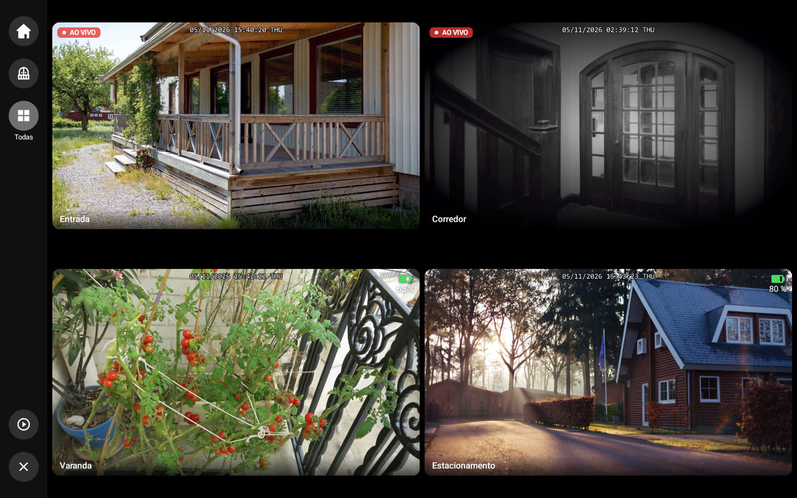
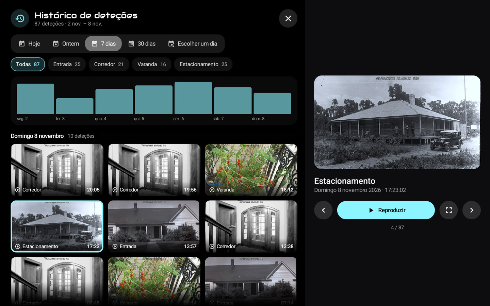

# 🏠 HA-MACS Android

[English](README.md) · [Français](README.fr.md) · [Deutsch](README.de.md) · [Español](README.es.md) · [Italiano](README.it.md) · [Nederlands](README.nl.md) · **Português** · [Polski](README.pl.md)

Um **painel Android nativo para o Home Assistant**, pensado para tablets de parede. Traz o aspeto de um painel
Lovelace em modo quiosque para uma app Jetpack Compose fluida, mesmo em tablets modestos: sem navegador, sem cartões
personalizados e sem nada para configurar no Home Assistant.

<p align="center">
  
  
</p>
<p align="center">
  
  
</p>
<p align="center">
  
  
</p>
<p align="center">
  
  
</p>
<p align="center">📸 <em>Dados de demonstração.</em></p>

## ✨ Funcionalidades

- 🤖 **M.A.C.S.**, a personagem animada, no centro do ecrã inicial, com a hora e uma meteorologia resumida; os seus olhos seguem o seu dedo
- 🧙 **Assistente de configuração**: divisões, membros, câmaras e elementos principais detetados no Home Assistant
- 🏠 **Divisões**: luzes, temperatura, humidade e aparelhos num relance
- 👨‍👩‍👧 **Membros**: presença (toque na barra para ver chegadas e saídas), hora de chegada, passos, bateria do telemóvel
  e próximos eventos
- 🧑‍🎨 **Avatares**: foto com a câmara do tablet, de um ficheiro ou de um telemóvel (código QR), recortada no
  dispositivo, filtros opcionais, cabeça a sair de um círculo com a cor do painel
- 📹 **Câmaras**: em direto, separadores personalizáveis, ecrã inteiro em alta definição com zoom, últimas deteções e o
  seu histórico (multimédia do HA, SMB, NFS, local); o ecrã inteiro fecha-se sozinho após um tempo (Definições › Ecrã),
  nunca durante uma deteção
  ; 🧱 **mural de câmaras**: grelha por separador ou todas, a partir dos separadores, do ecrã inicial ou do mosaico «+N»,
  direto conforme a alimentação (corrente, solar, bateria); uma campainha pode abrir a sua câmara em grande com outras
  em miniatura
- 🚨 **Alertas**: versão nativa do [AlertTicker Card](https://github.com/djdevil/AlertTicker-Card), 63 temas, som,
  voz e notificações
- 🌦️ **Meteorologia e gráficos**: previsão, radar Windy, consumo elétrico, preços dos combustíveis com o posto mais
  barato (toque num gráfico: cada posto, o seu preço e as últimas alterações)
- 🎵 **Música**: capa e as suas cores, progresso em direto, volume, aleatório e repetição, vários leitores; toque na
  capa para a biblioteca, a pesquisa, a fila, a fonte e as colunas
- 🎙️ **Assistente de voz**: fale com o M.A.C.S. através da sua gateway local ou como **satélite de voz do Home
  Assistant** (Wyoming, pipeline do Assist, palavra de ativação opcional); Definições › Assistente de voz
- ✏️ **Modo de edição**: altere entidades, divisões, separadores e blocos diretamente no tablet
- 🔒 **Modo quiosque**: ninguém sai da app nem desliga o tablet sem o código mestre (ou o de acesso)
- 🌍 **8 idiomas**: inglês, francês, alemão, espanhol, italiano, neerlandês, português, polaco

> 💡 **Nenhum sensor para criar no Home Assistant**: presença, dia/noite, avisos meteorológicos, melhor preço… a app
> calcula tudo a partir das entidades das suas integrações.

## 📋 Requisitos

- 📱 Tablet com **Android 8.0** ou posterior (ex. Galaxy Tab A8)
- 🏡 Home Assistant acessível a partir do tablet; nenhum token a criar: o assistente inicia sessão com a sua conta,
  *Com o telemóvel* (código QR, o gestor de palavras-passe do telemóvel preenche os campos) ou *No tablet*, ou usa um
  *Token de acesso*

## 🚀 Instalação

Descarregue o APK da [última Release](https://github.com/Arubinu/ha-macs-android/releases/latest) (`…-arm64-v8a.apk` para quase todos os tablets recentes) e
instale-o: depois a app atualiza-se sozinha. Para o compilar a partir do código-fonte:

```sh
# São necessários o Android SDK (plataforma 36) e o JDK 17
./gradlew assembleDebug
adb install -r app/build/outputs/apk/debug/app-debug.apk
```

No primeiro arranque, o **assistente** encontra o Home Assistant na rede, inicia sessão e adapta o painel à sua casa. Já
tem uma cópia de segurança? **Importe-a** no primeiro passo e está feito.

## 🍓 Raspberry Pi

Um Raspberry Pi 4 ou 5 com ecrã tátil é um bom painel de parede. Primeiro é preciso instalar-lhe o Android:

1. 📥 **LineageOS** (Android sem os serviços Google): no site de KonstaKANG, abra a página do [Pi 4](https://konstakang.com/devices/rpi4/) ou do
   [Pi 5](https://konstakang.com/devices/rpi5/), escolha a versão do LineageOS mais recente (não «Android TV») e descarregue o seu `.zip` (secção
   *Download*). Só a última versão tem ligação direta; as anteriores estão em *Previous builds*.
2. 💾 **Cartão microSD**: instale o [Raspberry Pi Imager](https://www.raspberrypi.com/software/), escolha o modelo do Pi e, na lista de sistemas, a
   última opção, *Use custom* (imagem personalizada): selecione o `.zip` descarregado e depois o cartão.
3. 📲 **A app**: arranque o Pi, conclua a configuração do Android e descarregue `…-arm64-v8a.apk` da
   [última Release](https://github.com/Arubinu/ha-macs-android/releases/latest) com o navegador do Pi (autorize a instalação de apps desconhecidas).

Uma webcam USB escolhe-se em Definições › Repouso e presença › *Câmara*. Sem os serviços Google, o recorte dos avatares
é um pouco menos preciso. Detalhes: [referência técnica](docs/reference.md#raspberry-pi) (em inglês).

⚡ **Alimentação**: use a fonte oficial (5,1 V / 3 A para o Pi 4, 5 V / 5 A para o Pi 5). O Pi não negocia USB Power
Delivery: a porta de uma dock ou de um carregador é muitas vezes fraca demais, sobretudo com webcams USB. Quando a tensão
desce (sinal HDMI perdido, lentidão), a app mostra *Alimentação insuficiente* no fundo do ecrã.

## ⚙️ No dia a dia

- ⚙️ **Definições**: toque longo no canto superior esquerdo (ligação, ecrã, suspensão, código de acesso, idioma…)
- 🔑 **Código mestre** (opcional, no assistente ou em Definições › Segurança): pedido antes de abrir as definições
- ✏️ **Modo de edição**: Definições › Painel › *Editar os blocos*, depois toque num bloco para o alterar
- 💾 **Cópia de segurança**: Definições › Painel › *Exportar* / *Importar* / *Com o telemóvel* (código QR); o token e
  os códigos são cifrados para este tablet (noutro são pedidos novos códigos), mas o ficheiro continua pessoal
  (esquema, fotografias dos avatares)
- 🔄 **Atualizações**: Definições › Acerca de › *Atualizações*; as novas versões (e as pré-versões, se quiser)
  instalam-se sozinhas, a app volta a abrir após uma atualização ou uma falha e mostra uma vez as *Novidades*
- 🌙 **Modo noturno**: Definições › Repouso e presença › *Modo noturno*; do pôr ao nascer do sol (ou a horas fixas),
  o ecrã fica preto mais depressa e acende-se com um toque ou uma presença
- 🔔 **Campainha**: no modo de edição, *Abrir num evento* de uma câmara mostra-a em ecrã inteiro quando uma campainha
  ou um detetor é acionado, com um som
- 📡 **Tablet no Home Assistant**: Definições › Home Assistant; sensores de bateria, ecrã e presença, e notificações
  (faixa, leitura em voz alta, ecrã aceso, câmara em ecrã inteiro)
- 🔊 **Leitor multimédia**: o Home Assistant encontra o tablet (DLNA) e pode reproduzir nele síntese de voz, rádios ou
  Music Assistant; Definições › Home Assistant
  (acesso: Home Assistant e dispositivos aprovados, ou toda a rede)
- 🌍 **Acesso pela Internet**: proxy inverso https (Pangolin, Cloudflare Access…) com os seus cabeçalhos;
  Definições › Home Assistant › *Proxy inverso*
- 🧙 **Assistente**: pode ser relançado em Definições › Painel

## 🔒 Modo quiosque

Definições › Segurança › **Modo quiosque**. Para um bloqueio completo (Início, apps recentes, notificações e menu de
energia bloqueados), torne a app *proprietária do dispositivo* uma única vez, a partir de um computador, sem nenhuma
conta ligada no tablet:

```sh
adb shell dpm set-device-owner fr.pergens.hamacs/.kiosk.KioskAdmin
```

📷 Sem computador: *Preparar o tablet* (abaixo) mostra um código QR para ler no ecrã de boas-vindas após uma
reposição (6 toques no mesmo sítio). Mais simples: escolher a app como ecrã inicial; volta com o botão Início e no
arranque, mas um gesto do Android pode retirar a fixação de ecrã.

🔁 Como proprietária, a app também pode reiniciar o dispositivo: Definições › Segurança › *Reiniciar o dispositivo*
(o Android não permite que uma app o desligue).

⚠️ Antes de desinstalar: Definições › Segurança › *Retirar os direitos de proprietário*.

✅ Definições › Segurança › *Preparar o tablet* verifica tudo de uma vez: quiosque, proprietário ou ecrã inicial,
código mestre, reabertura após uma falha, bateria e animações, cada um com a sua solução.

## 🎙️ Assistente de voz (opcional)

Um pequeno gateway em Python (`gateway/`, pronto para Docker) envia o microfone do tablet para um modelo de áudio
local (LFM3-Audio via llama-server) e executa as ações do Home Assistant. Os comandos simples («acende a luz da sala»)
são executados de imediato, sem o modelo.

```sh
cd gateway && docker compose up -d
```

## 🛠️ Para ir mais longe

- ❓ [FAQ](docs/faq.pt.md): tablets compatíveis, Raspberry Pi, câmaras, atualizações, problemas
- 🐛 Algum problema? Definições › Acerca de › *Registo de falhas*: copie-o para um [relatório](https://github.com/Arubinu/ha-macs-android/issues/new/choose)
- 📖 [Referência técnica](docs/reference.md) (em inglês): `dashboard.json`, tipos de cartões, deteções,
  AlertTicker, modo de edição, gateway de voz

## 📄 Licença

O código está sob a [licença MIT](LICENSE). Os recursos de terceiros mantêm a sua própria licença:

- 🤖 [M.A.C.S.](https://github.com/glyndavidson/MACS) de Glyn Davidson e
  [hass-hue-icons](https://github.com/arallsopp/hass-hue-icons): **CC BY-NC-SA 4.0**, apenas uso não comercial
- 🎨 [Material Design Icons](https://pictogrammers.com/library/mdi/) (Apache 2.0),
  [Meteocons](https://github.com/basmilius/weather-icons) (MIT), tipos de letra Audiowide e
  [Carlito](https://github.com/googlefonts/carlito) (OFL), temas e traduções do
  [AlertTicker Card](https://github.com/djdevil/AlertTicker-Card) (MIT)
- 📚 [smbj](https://github.com/hierynomus/smbj) e [nfs-client-java](https://github.com/EMCECS/nfs-client-java)
  (Apache 2.0)
