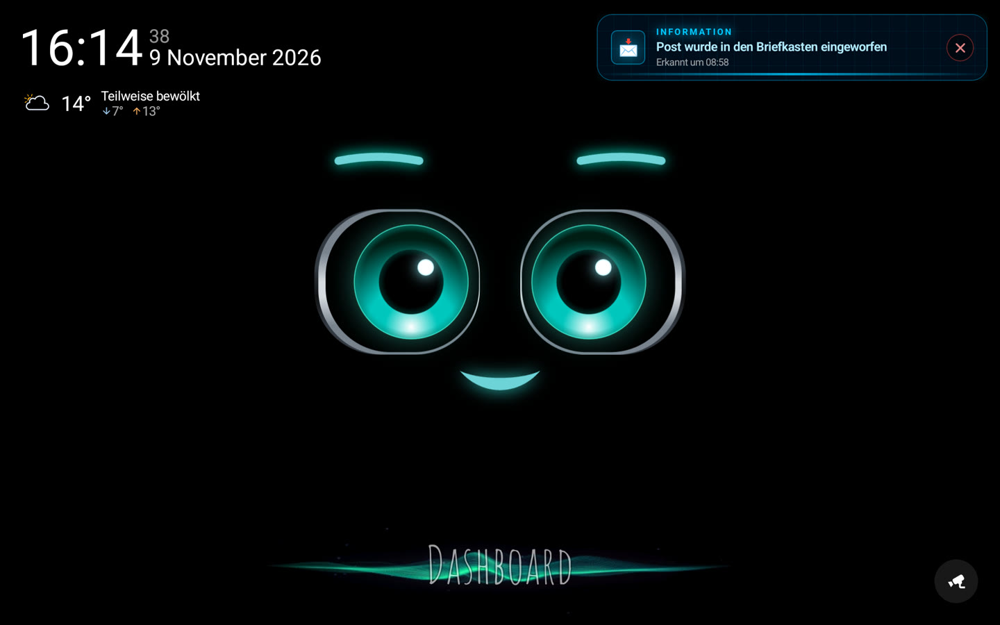
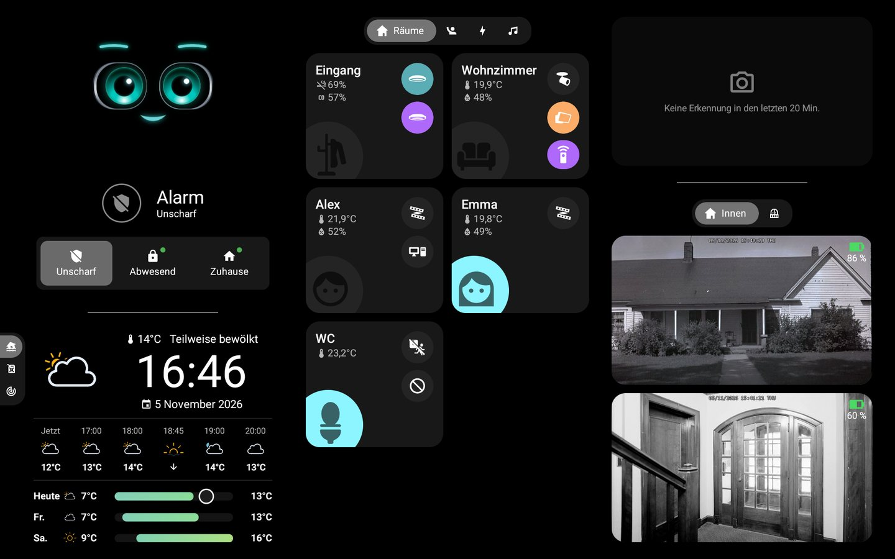
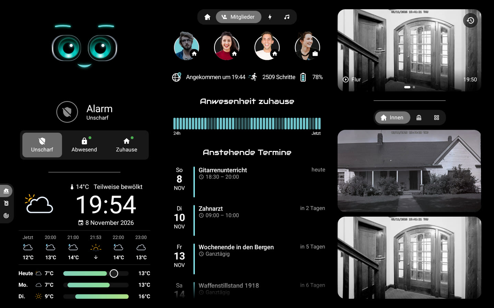
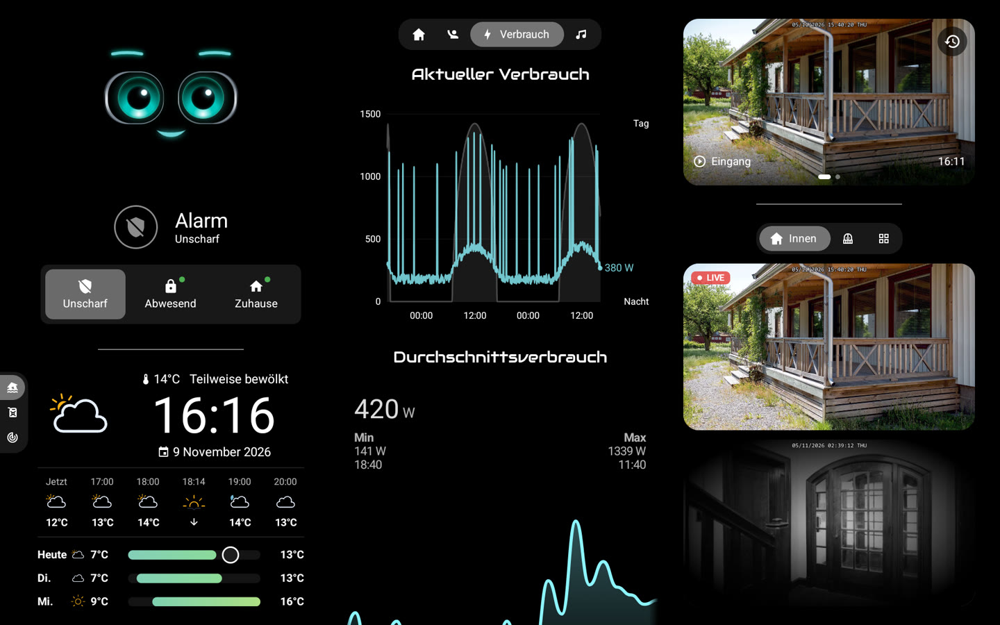
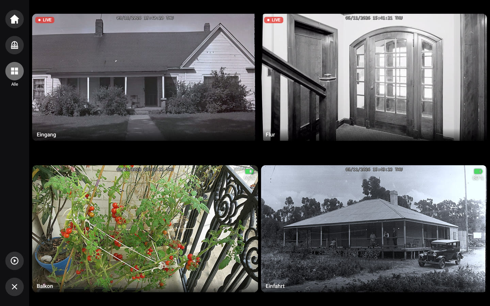
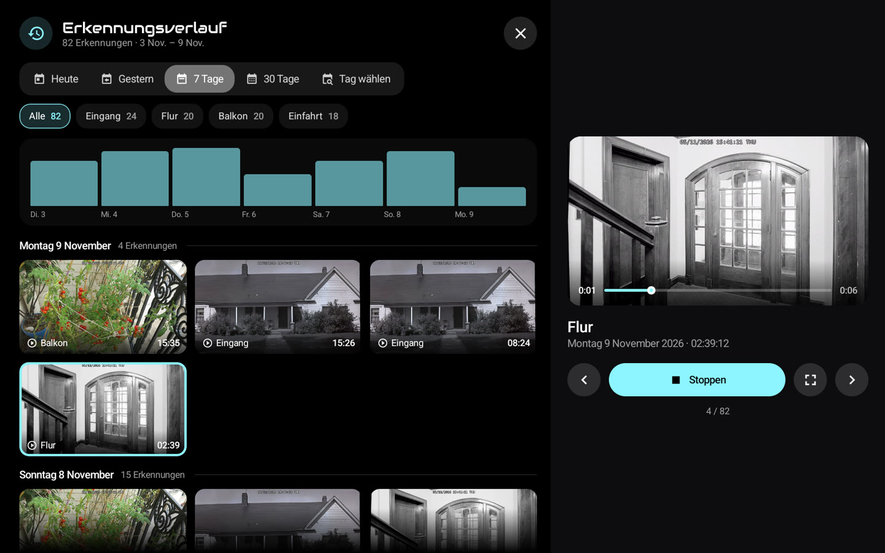
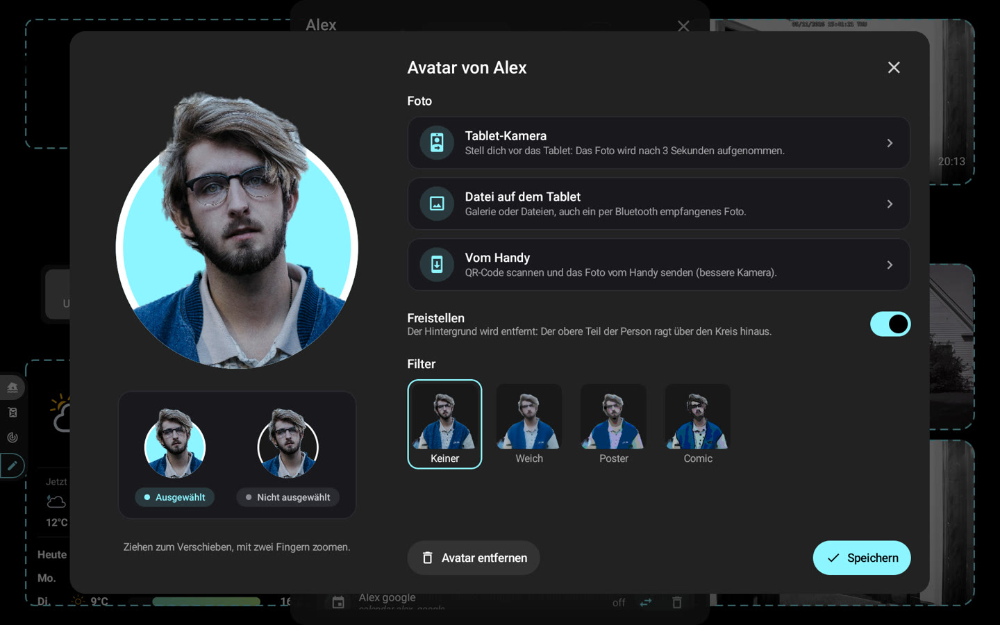

# 📸 Screenshots

[← README](../../../README.de.md) · *Demodaten.*

### Startbildschirm: M.A.C.S., Uhrzeit und Wetter

### Dashboard: Räume, Alarm, Wetter und Kameras

### Mitglieder: Anwesenheit, Avatare und nächste Termine

### Energie und Live-Kameras

### Kamerawand, live je nach Stromversorgung

### Erkennungsverlauf während der Wiedergabe

### Avatar-Editor: Freistellen und Filter

### Vollbild-Zoom mit Wiedergabeleiste

