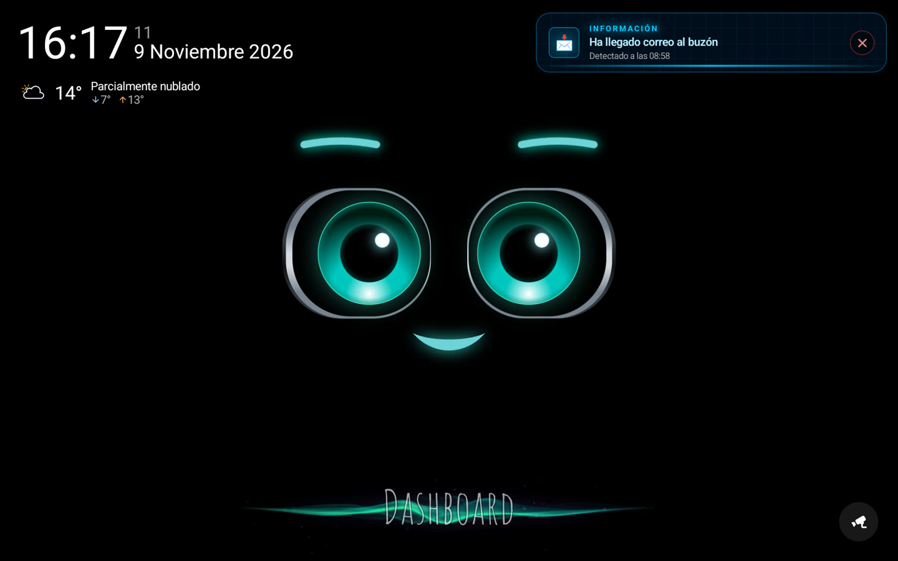
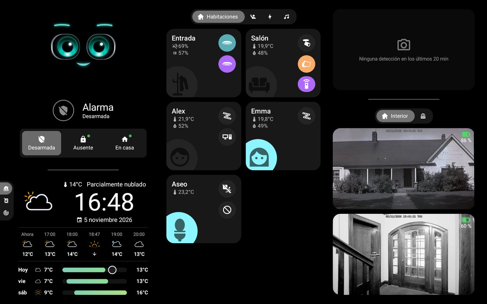
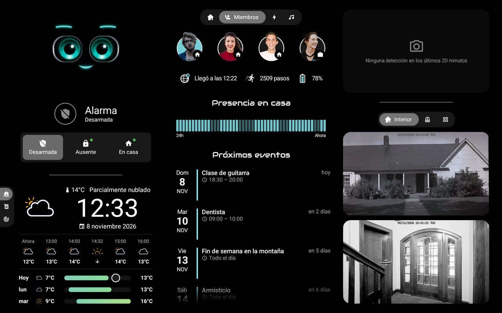
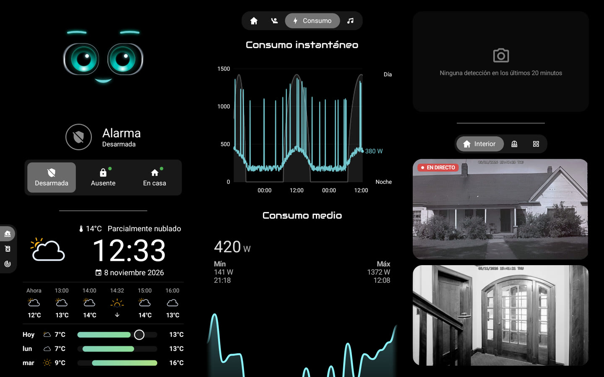
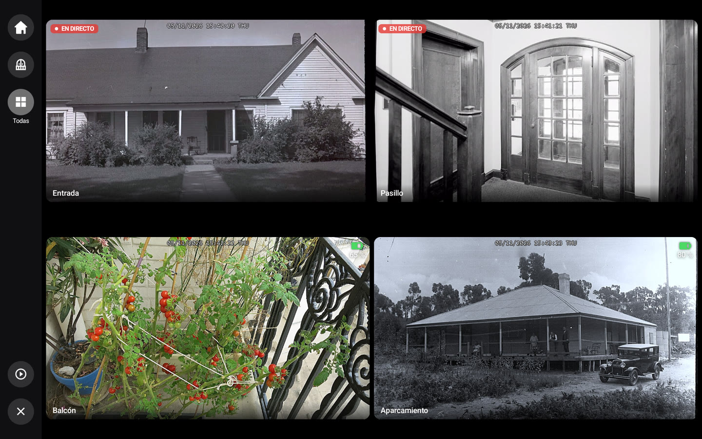
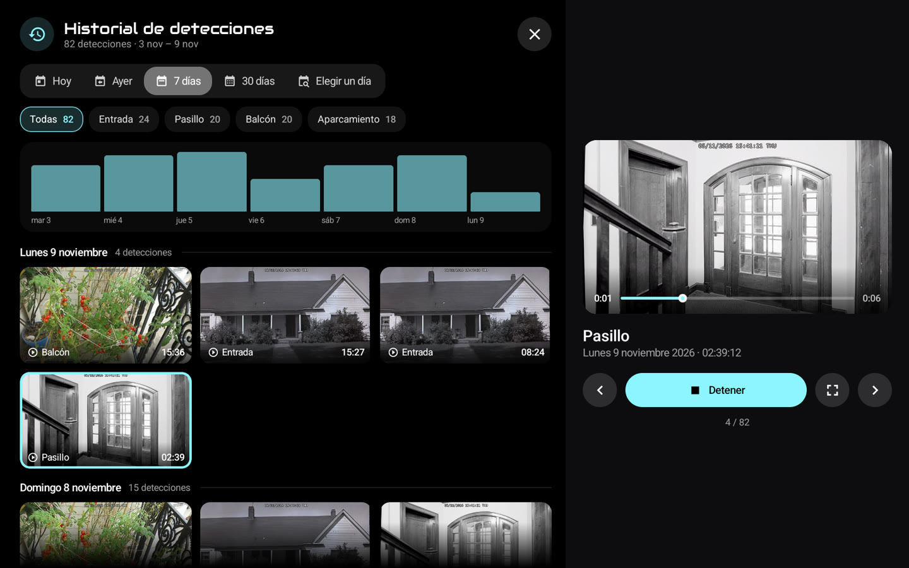
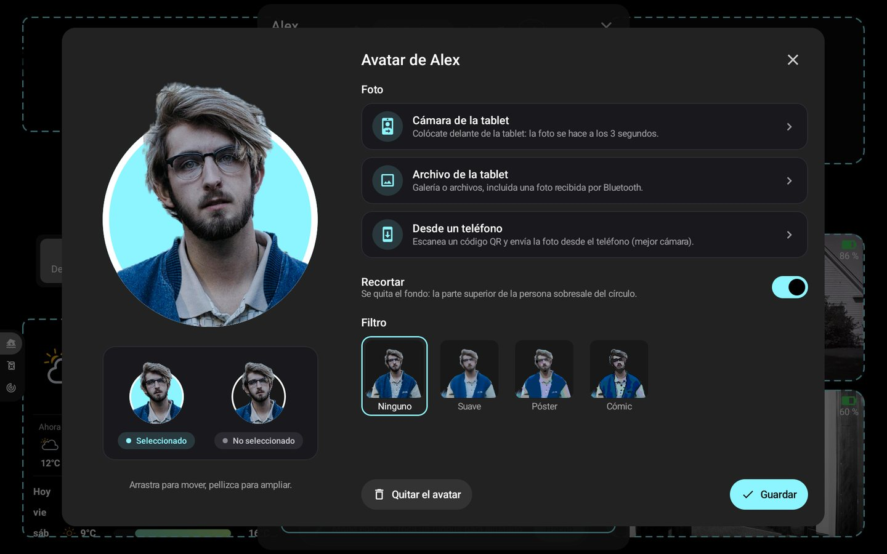

# 📸 Capturas de pantalla

[← README](../../../README.es.md) · *Datos de demostración.*

### Inicio: M.A.C.S., la hora y el tiempo

### Panel: habitaciones, alarma, tiempo y cámaras

### Miembros: presencia, avatares y próximos eventos

### Energía y cámaras en directo

### Muro de cámaras, en directo según la alimentación

### Historial de detecciones durante una reproducción

### Editor de avatar: recorte y filtros

### Pantalla completa con zoom y barra de reproducción

