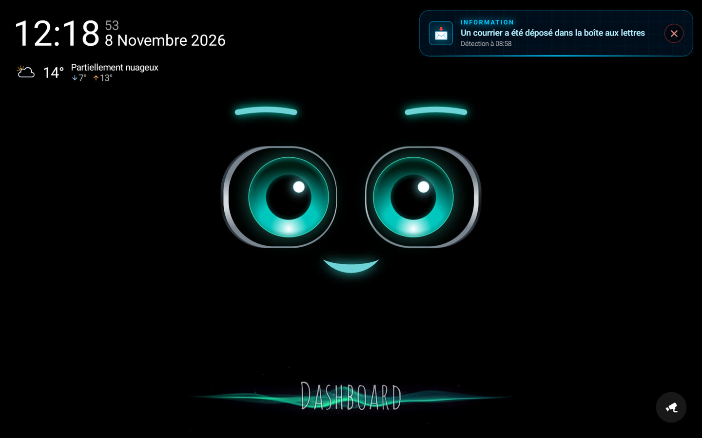
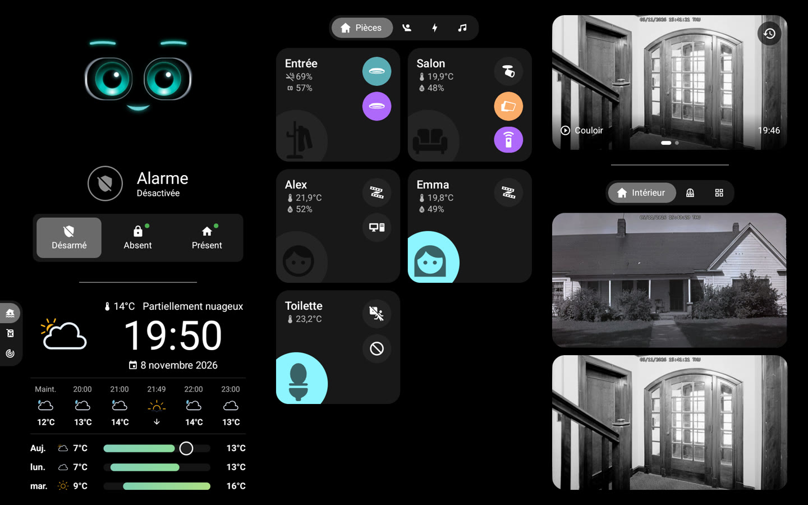
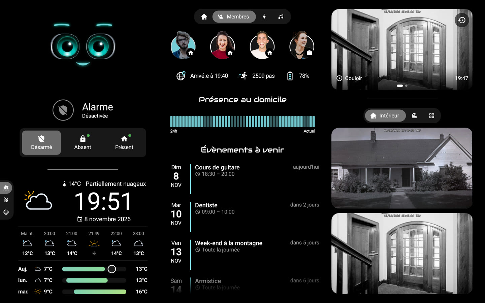
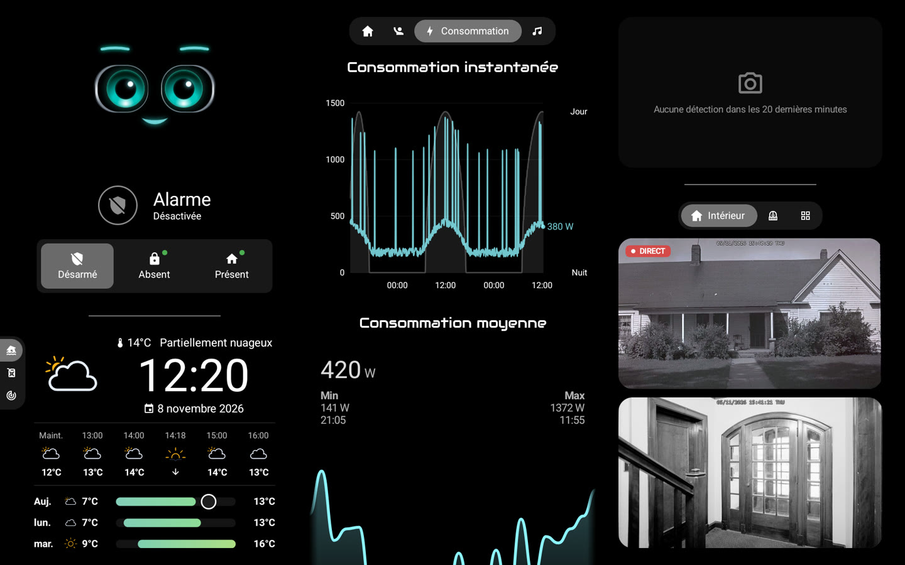
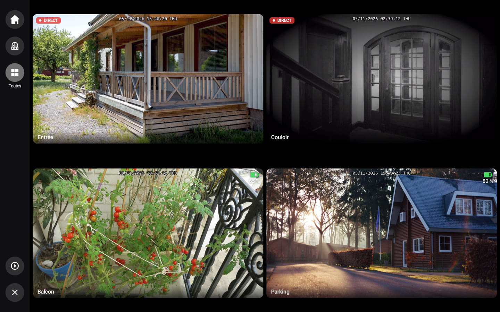
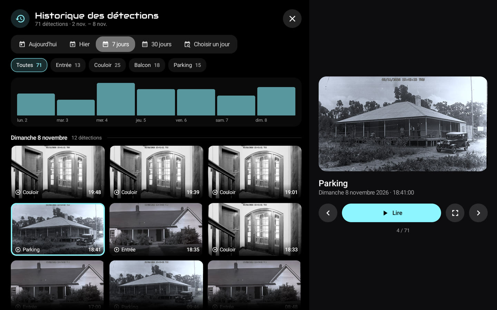
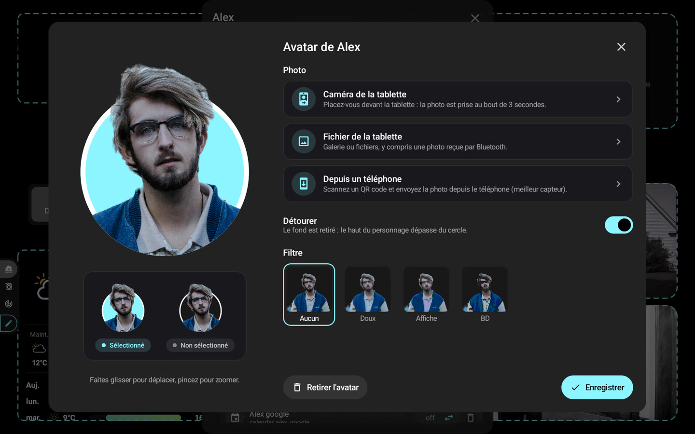

# 📸 Captures d'écran

[← README](../../../README.fr.md) · *Données de démonstration.*

### Accueil : M.A.C.S., l'heure et la météo

### Tableau de bord : pièces, alarme, météo et caméras

### Membres : présence, avatars et prochains événements

### Énergie et caméras en direct

### Mur de caméras, en direct selon l'alimentation

### Historique des détections pendant une lecture

### Éditeur d'avatar : détourage et filtres

### Plein écran zoomé avec la barre de lecture

