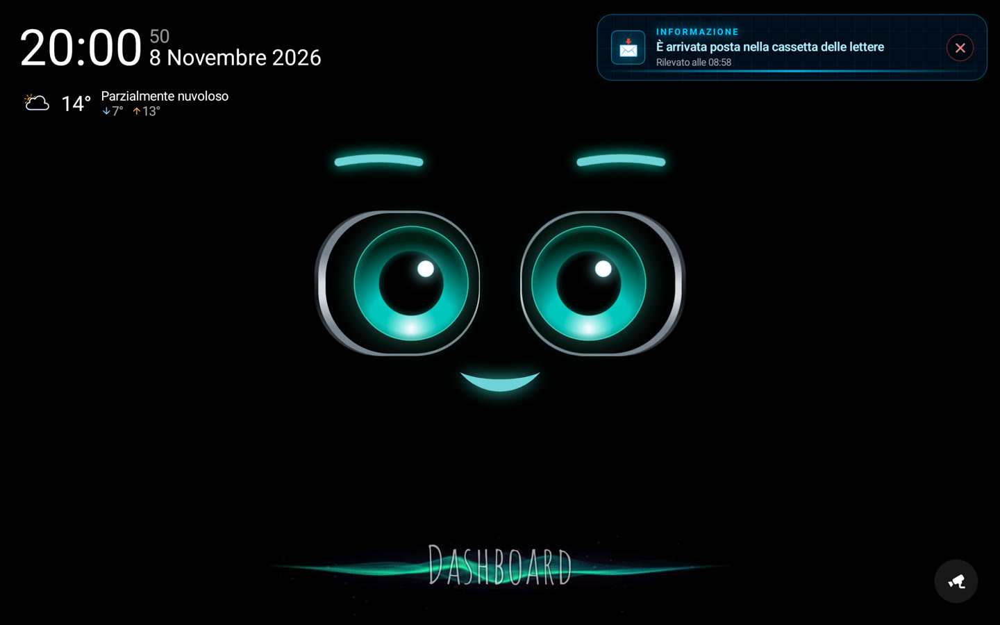
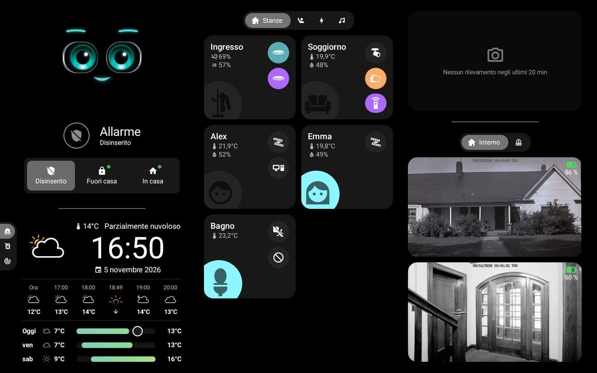
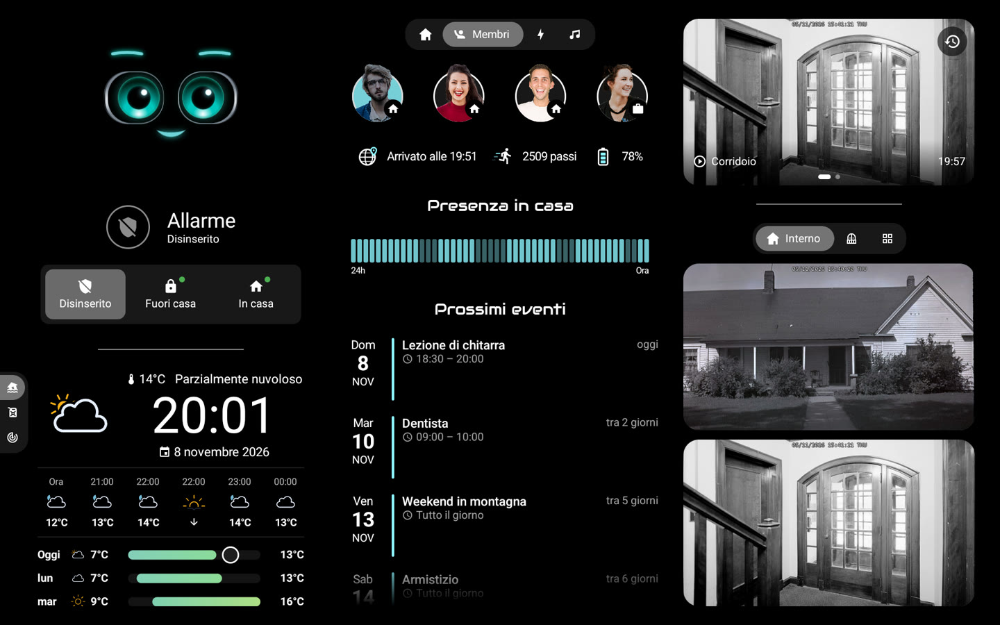
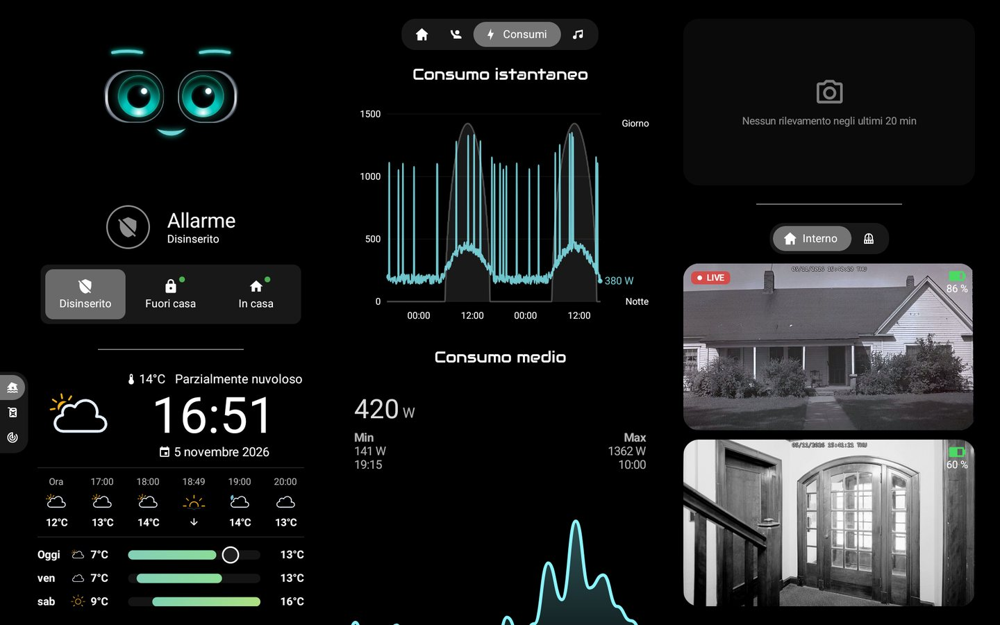
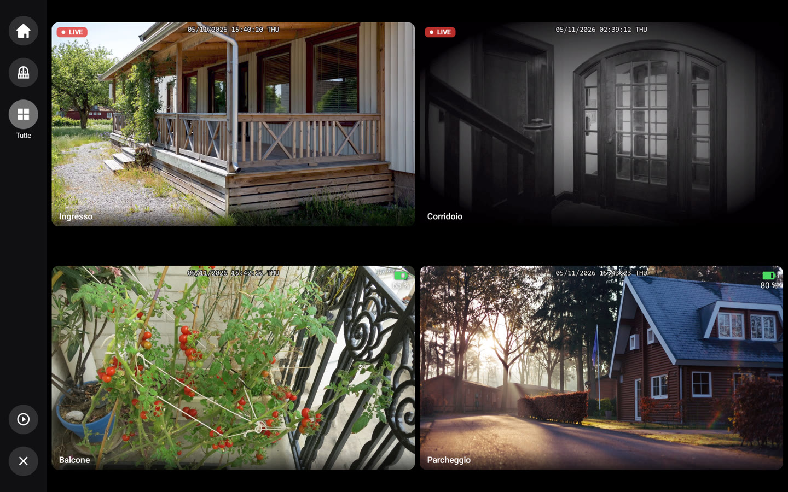
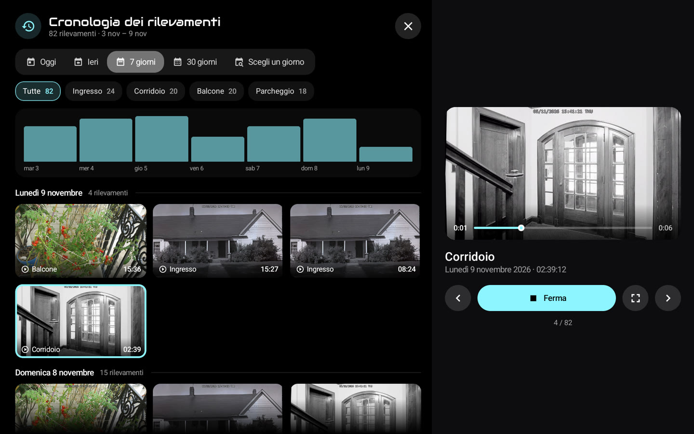
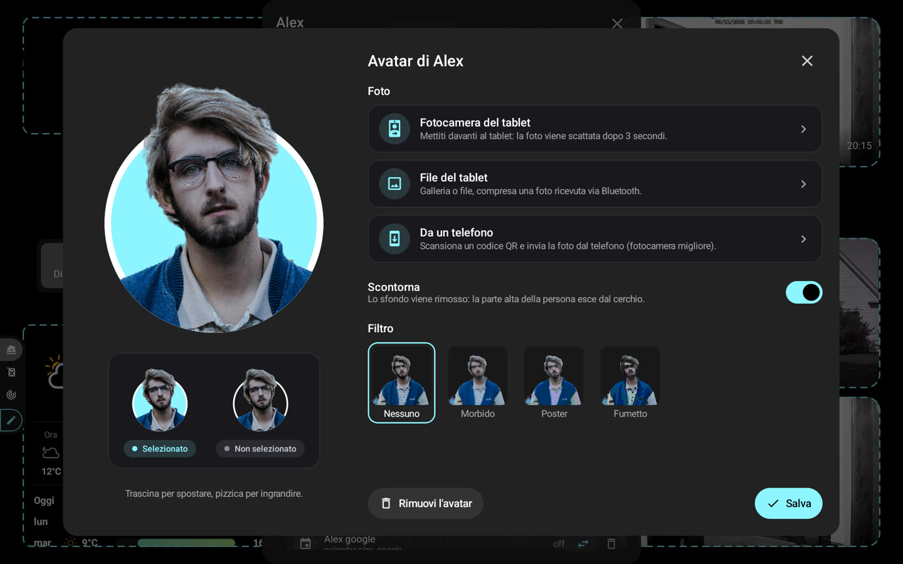

# 📸 Schermate

[← README](../../../README.it.md) · *Dati dimostrativi.*

### Schermata iniziale: M.A.C.S., ora e meteo

### Dashboard: stanze, allarme, meteo e telecamere

### Membri: presenza, avatar e prossimi eventi

### Energia e telecamere in diretta

### Muro di telecamere, in diretta secondo l'alimentazione

### Cronologia dei rilevamenti durante la riproduzione

### Editor dell'avatar: scontorno e filtri

### Schermo intero con zoom e barra di riproduzione

