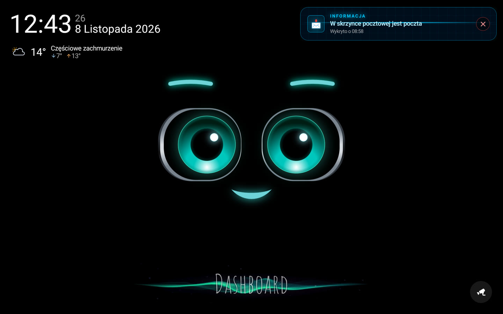
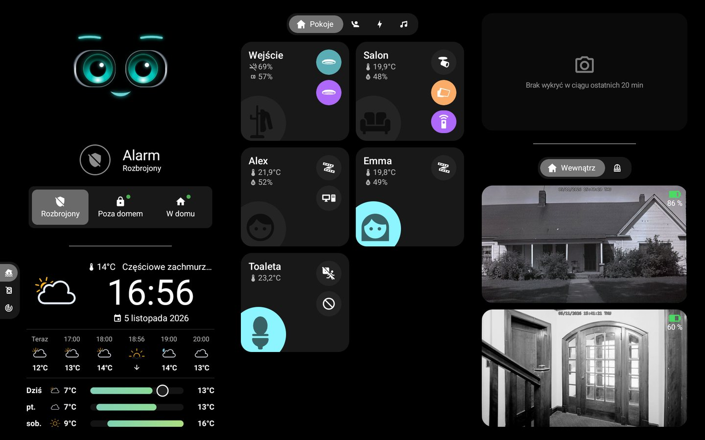
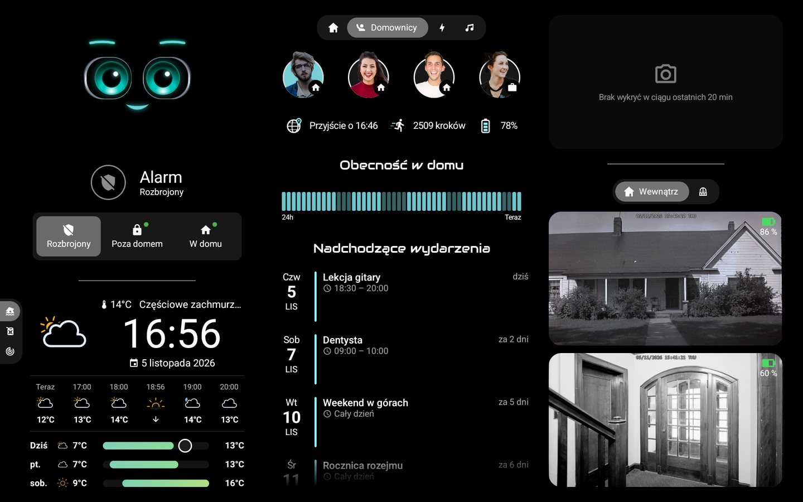
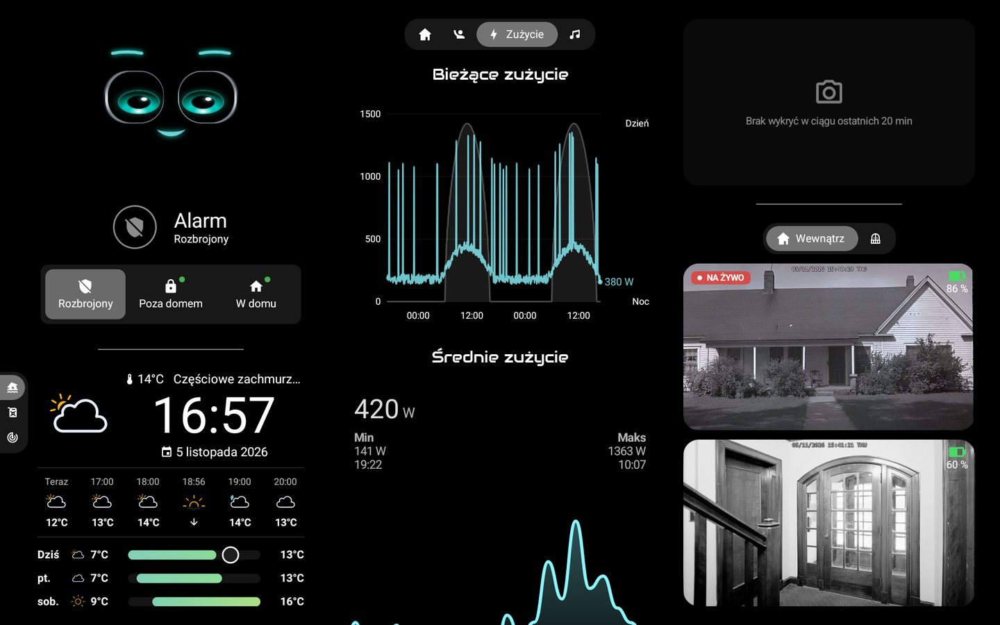
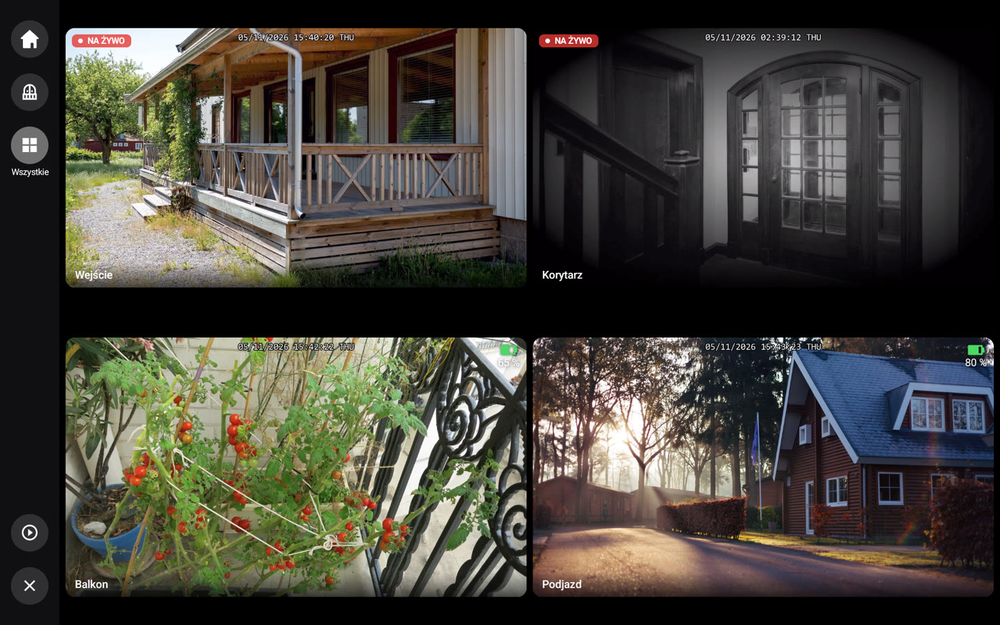
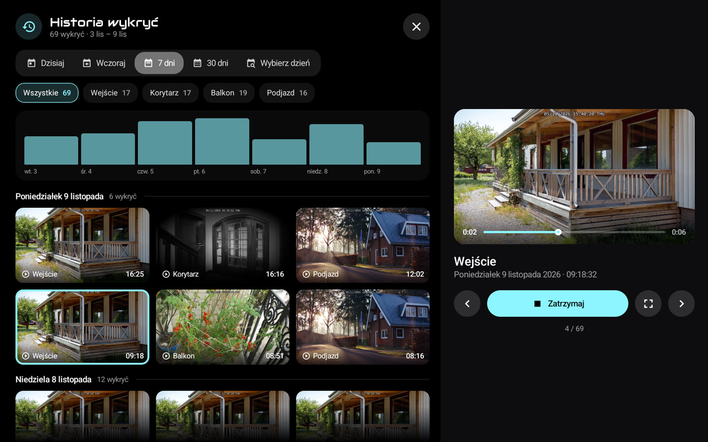
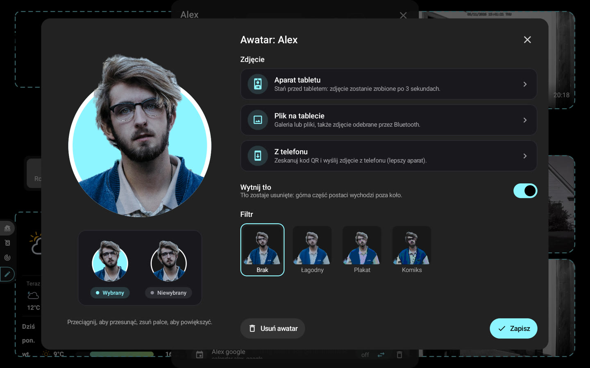

# 📸 Zrzuty ekranu

[← README](../../../README.pl.md) · *Dane demonstracyjne.*

### Ekran główny: M.A.C.S., godzina i pogoda

### Panel: pomieszczenia, alarm, pogoda i kamery

### Członkowie: obecność, awatary i najbliższe wydarzenia

### Energia i kamery na żywo

### Ściana kamer, na żywo zależnie od zasilania

### Historia wykryć podczas odtwarzania

### Edytor awatara: wycinanie i filtry

### Pełny ekran z powiększeniem i paskiem odtwarzania

