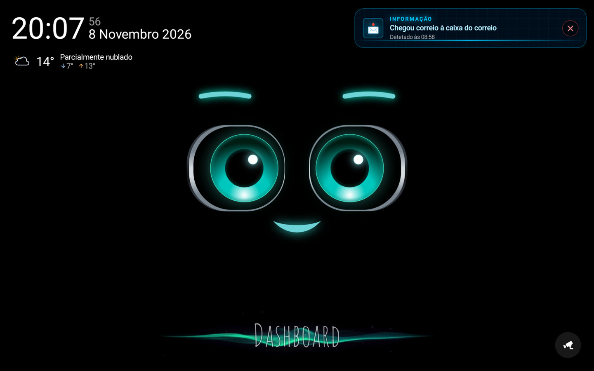
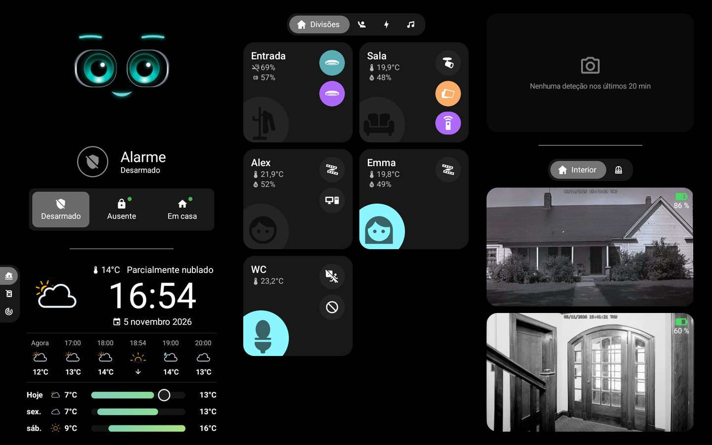
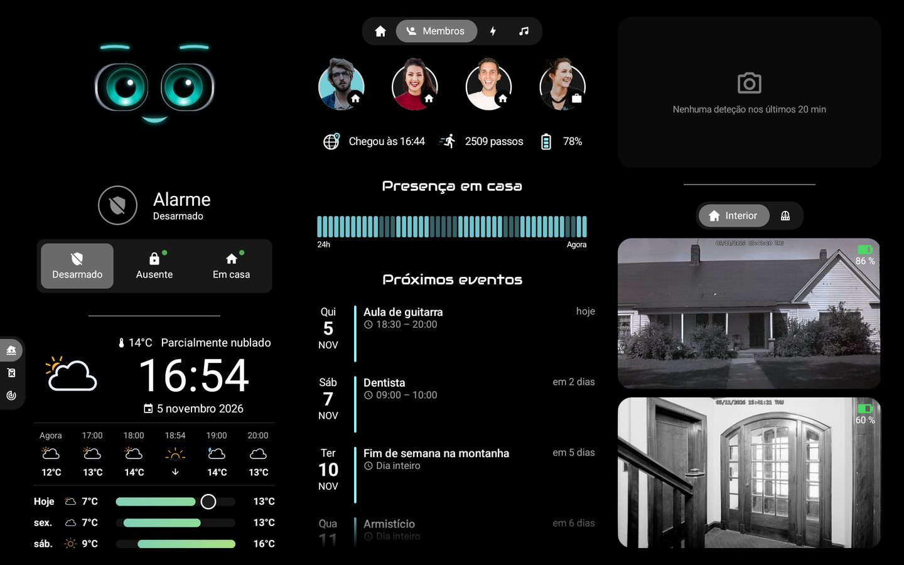
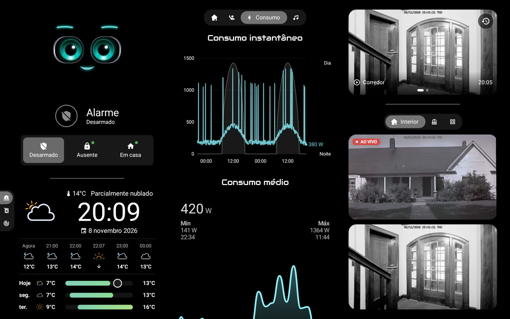
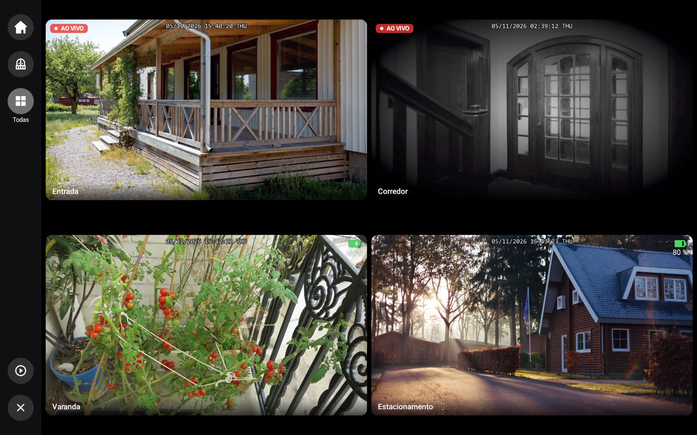
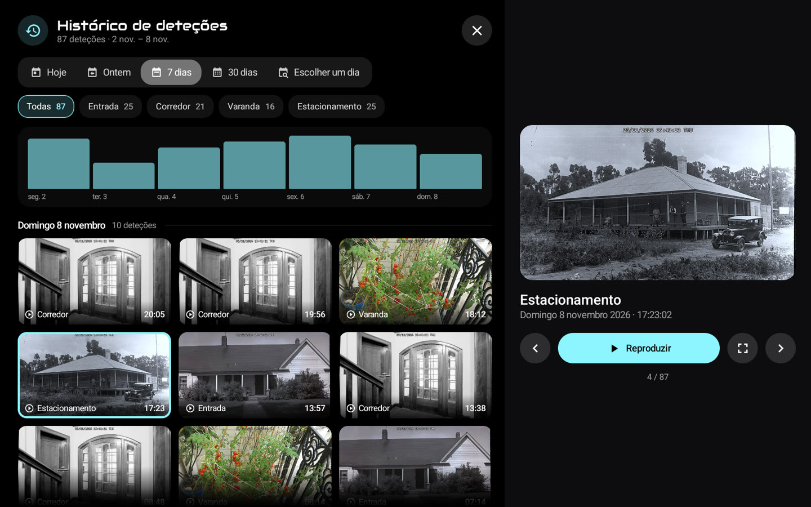
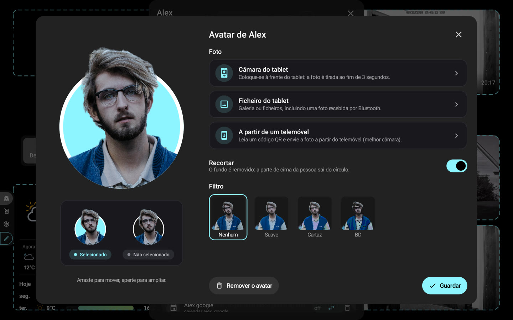

# 📸 Capturas de ecrã

[← README](../../../README.pt.md) · *Dados de demonstração.*

### Ecrã inicial: M.A.C.S., hora e meteorologia

### Painel: divisões, alarme, meteorologia e câmaras

### Membros: presença, avatares e próximos eventos

### Energia e câmaras em direto

### Mural de câmaras, em direto conforme a alimentação

### Histórico de deteções durante a reprodução

### Editor de avatar: recorte e filtros

### Ecrã inteiro com zoom e barra de reprodução

